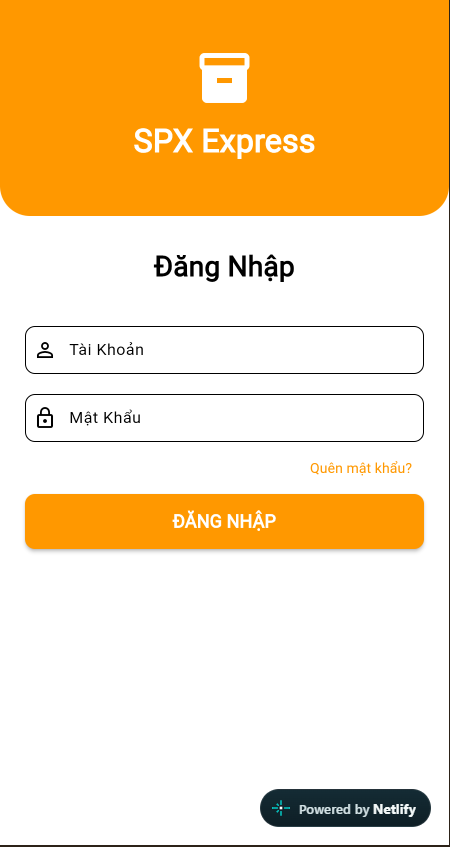
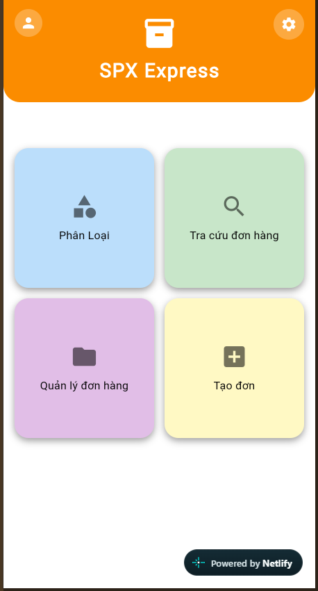
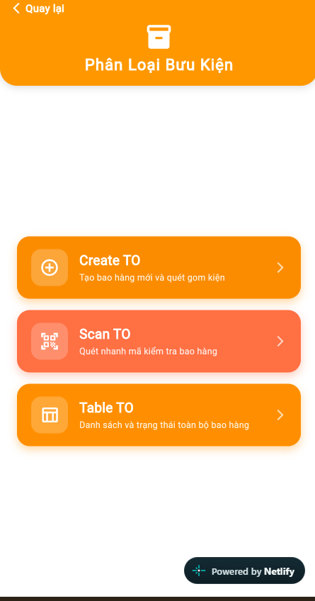
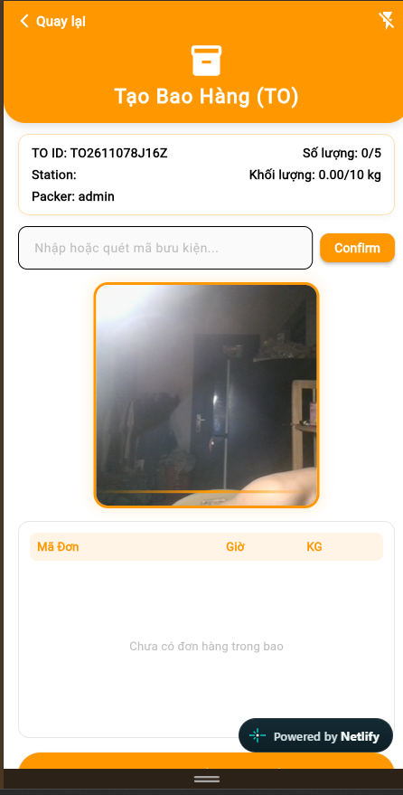
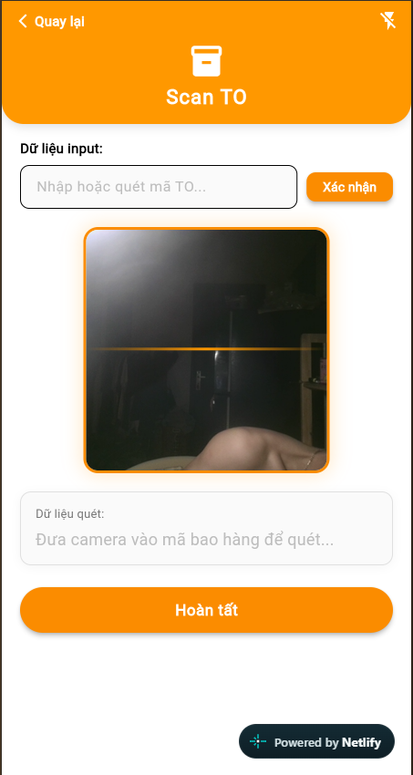
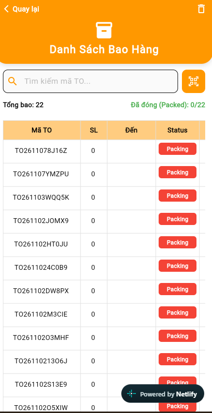
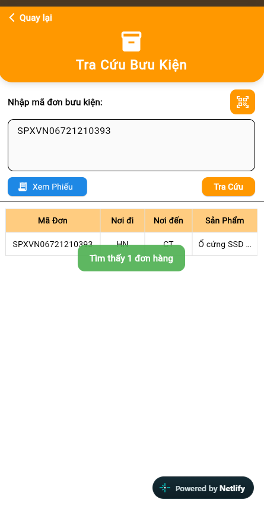
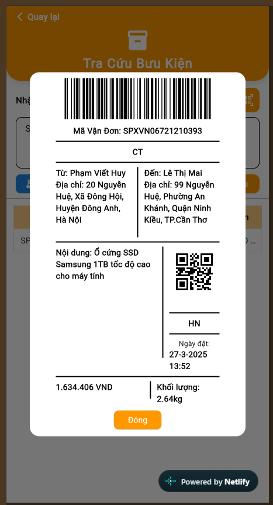
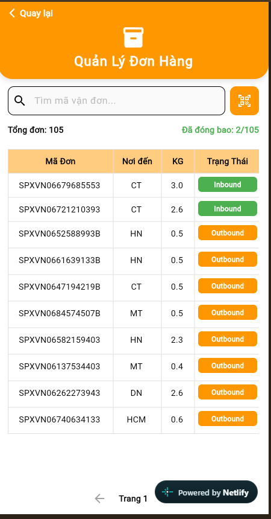
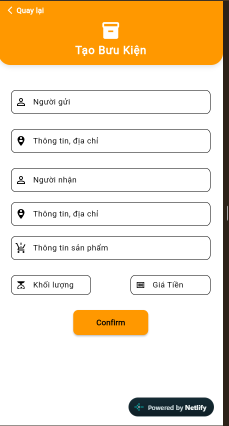

# SPX Express Mobile App (Flutter)

Ứng dụng di động chuyên dụng dành cho nhân viên điều phối và thao tác bưu cục SPX Express. Ứng dụng hỗ trợ quét mã vạch / QR Code tốc độ cao qua camera di động, quản lý bao hàng trung chuyển (Transfer Order - TO), tạo đơn hàng nhanh và tra cứu thông tin đơn hàng thời gian thực.

---


---

## 📸 Giao Diện Trực Quan Ứng Dụng (Mobile UI Screenshots)

Toàn bộ màn hình của ứng dụng Flutter được thiết kế phân tầng nghiệp vụ khoa học:

### 1. Đăng Nhập & Menu Chính (Home Menu)
| 1.1. Màn Hình Đăng Nhập | 1.2. Màn Hình Menu Điều Hướng Chính |
| :---: | :---: |
|  |  |

---

### 2. Phân Hệ Phân Loại & Gom Bao Hàng (TO Management)
Gồm 3 chức năng chính được phân cấp rõ ràng: **Create TO** ➔ **Scan TO** ➔ **Table TO**:

| 2.1. Menu Điều Hướng Phân Loại (3 Tab Chính) | 2.2. Tab 1: Tạo Mới Bao Hàng (Create TO) |
| :---: | :---: |
|  |  |

| 2.3. Tab 2: Quét Mã Gom Bao (Scan TO) | 2.4. Tab 3: Danh Sách Quản Lý Bao (Table TO) |
| :---: | :---: |
|  |  |

---

### 3. Phân Hệ Tra Cứu & In Phiếu Vận Đơn (Tracking & Bill)
| 3.1. Tra Cứu Thông Tin Vận Đơn | 3.2. Mẫu In Phiếu Bưu Kiện (Barcode + QR Code) |
| :---: | :---: |
|  |  |

---

### 4. Phân Hệ Quản Lý Đơn Hàng & Tạo Mới Đơn Hàng
| 4.1. Bảng Quản Lý Toàn Bộ Đơn Hàng | 4.2. Form Tạo Mới Bưu Kiện & Nhận Diện Hub |
| :---: | :---: |
|  |  |

---

## 🌐 Trải Nghiệm Ứng Dụng Trên Trình Duyệt (Flutter Web Live)
- **Đường dẫn chạy thử:** [https://tranquil-figolla-16df43.netlify.app](https://tranquil-figolla-16df43.netlify.app)
- **Tải gói build sẵn để tự upload:** Tải tệp nén spx_mobile_web_build.zip và thả vào [Netlify Drop](https://app.netlify.com/drop).

## 📱 Các Chức Năng Chính

### 1. Quản lý Bao Hàng Trung Chuyển (TO Management)
- **Tạo mới bao hàng (Create TO):**
  - Tự động sinh mã TO chuẩn định dạng: `TO` + `{năm-tháng-ngày}` + `{5 ký tự ngẫu nhiên}` (Ví dụ: `TO261102WNZAJ`).
  - Gán nhân viên đóng bao (`Packer`), khởi tạo trọng lượng và số lượng kiện.
- **Trạm quét mã phân loại đóng bao (Scan TO):**
  - Tích hợp thư viện quét mã vạch camera chuyên dụng `mobile_scanner` tốc độ cao, hỗ trợ lấy nét và bật/tắt đèn Flash khi làm việc trong kho tối.
  - Phản hồi âm thanh chuẩn qua `audioplayers` (âm thanh Beep thông báo thành công và âm thanh cảnh báo lỗi khi quét sai).
  - Kiểm tra và tự động chặn quét đơn khác tuyến nơi nhận so với gói hàng đầu tiên trong bao.
  - Chức năng xóa gỡ gói hàng khỏi bao trực tiếp ngay trên màn hình quét.
  - Hoàn tất đóng bao: Cập nhật trạng thái `Packed`, chốt tổng khối lượng và số lượng kiện trong bao.
- **Danh sách bao hàng (TO Table):**
  - Theo dõi danh sách các bao đang đóng dở (`Packing`) và các bao đã đóng xong (`Packed`).
  - Cho phép xem chi tiết danh sách gói hàng bên trong từng bao.
  - Hỗ trợ tính năng **ReOpen**: Mở lại bao đã đóng để tiếp tục quét thêm hoặc điều chỉnh kiện hàng.

### 2. Quản lý & Tạo Đơn Hàng Thông Minh (Smart Order Creation)
- **Tạo đơn hàng nhanh:** Nhập thông tin người gửi, người nhận, số điện thoại, địa chỉ, hàng hóa, khối lượng và tiền thu hộ (COD).
- **Thuật toán sinh mã vận đơn SPX:** Tự động sinh mã duy nhất theo chuẩn Shopee Xpress:
  $$\text{SPXVN} + \text{Mã năm} + \text{8 số ngẫu nhiên} + \text{Ký tự tháng}$$
- **Tự động nhận diện Hub vùng đích (Smart Address Routing):**
  - Tích hợp chuẩn hóa chuỗi và thuật toán đối sánh mờ Levenshtein (`diacritic`).
  - Tự động phân tích địa chỉ của 63 tỉnh/thành về 5 Hub bưu cục chính: `HN` (Hà Nội), `HCM` (TP. Hồ Chí Minh), `DN` (Đà Nẵng), `CT` (Cần Thơ), `MT` (Miền Trung).

### 3. Tra Cứu Vận Đơn (Tracking & Verification)
- Quét barcode hoặc nhập mã SPX để tra cứu trạng thái đơn hàng tức thì.
- Xem chi tiết lịch sử đóng bao, thời gian tạo đơn, hành trình và thông tin người nhận.
- Xem và chia sẻ phiếu vận đơn (Bill bưu kiện điện tử).

### 4. In & Hiển Thị Phiếu Vận Đơn (Bill & Barcode Generation)
- Tích hợp `barcode_widget` và `qr_flutter` tạo mã vạch Code128 cùng QR Code sắc nét.
- Mẫu phiếu in tiêu chuẩn SPX Express: Bao gồm Barcode mã vận đơn, mã QR đích đến, thông tin người gửi/người nhận, ghi chú hàng hóa và số tiền COD.
- Mẫu in phiếu bao hàng TO (TO Bill): Thể hiện đầy đủ mã bao, tổng tải trọng, số lượng kiện và chữ ký xác nhận của nhân viên bưu cục.

### 5. Cài Đặt & Cấu Hình Hệ Thống (Settings)
- Hỗ trợ đổi linh hoạt địa chỉ máy chủ API (Local Server hoặc Backend Cloud Railway).
- Lưu cấu hình cục bộ thiết bị thông qua `shared_preferences`.
- Bật/tắt phản hồi âm thanh khi quét mã.

---

## 🛠️ Công Nghệ & Thư Viện Sử Dụng

| Thư viện | Phiên bản | Mục đích sử dụng |
| :--- | :--- | :--- |
| **Flutter SDK** | `^3.10.0` | Nền tảng phát triển ứng dụng di động đa nền tảng |
| **`mobile_scanner`** | `^7.2.0` | Quét mã vạch Barcode và QR Code bằng camera điện thoại |
| **`http`** | `^1.2.0` | Giao tiếp REST API với Backend Node.js |
| **`audioplayers`** | `^6.1.0` | Phát âm thanh phản hồi thao tác quét mã (Beep/Buzz) |
| **`barcode_widget`** | `^2.0.3` | Tạo và hiển thị mã vạch Code128 trên phiếu vận đơn |
| **`qr_flutter`** | `^4.1.0` | Sinh mã QR Code trên tem phiếu bưu kiện |
| **`shared_preferences`** | `^2.2.2` | Lưu trữ cấu hình IP/URL server và cài đặt trên máy |
| **`diacritic`** | `^0.1.3` | Bỏ dấu tiếng Việt phục vụ thuật toán nhận diện tỉnh/thành |
| **`intl`** | `^0.19.0` | Định dạng tiền tệ VND, ngày giờ chuẩn Việt Nam |
| **`share_plus`** | `^7.2.1` | Chia sẻ thông tin phiếu đơn hàng |

---

## 📁 Cấu Trúc Thư Mục Source Code (`lib/`)

```text
lib/
├── BILL/                     # Giao diện & tạo mẫu in phiếu vận đơn, phiếu bao TO
│   ├── BillScreen.dart       # Mẫu phiếu bưu kiện đơn hàng (SPX Bill)
│   └── BillTo.dart           # Mẫu phiếu bao hàng trung chuyển (TO Bill)
├── data/
│   └── api_service.dart      # Service quản lý toàn bộ các lời gọi HTTP API
├── Login/
│   └── LoginScreen.dart      # Màn hình đăng nhập nhân viên
├── models/                   # Các Data Model (Order, TO, Logo)
│   ├── Oders_model.dart      # Model thông tin đơn hàng
│   ├── to_model.dart         # Model thông tin bao hàng TO
│   └── appbar_logo.dart      # Widget AppBar thương hiệu SPX
├── PhanLoai/                 # Phân hệ Quản lý & Phân loại bao hàng TO
│   ├── create_TO/            # Màn hình & logic khởi tạo bao hàng mới
│   ├── danhsach-TO/          # Bảng dữ liệu quản lý các bao hàng trong kho
│   ├── Scan_to/              # Màn hình quét camera đóng gói đơn vào bao
│   ├── ketqua_to_Screen.dart # Màn hình xác nhận hoàn tất đóng bao
│   ├── PhanLoaiScreen.dart   # Màn hình chính phân loại hàng hóa
│   └── to_management_screen.dart # Điều hướng phân hệ TO
├── QuanLy/                   # Màn hình tổng hợp quản lý đơn hàng
│   ├── QuangLy_logic.dart
│   └── QuanLyscreen.dart
├── Setting/                  # Cài đặt kết nối Server và âm thanh
│   └── SettingScreen.dart
├── TaoDon/                   # Phân hệ Tạo đơn hàng & thuật toán định tuyến
│   ├── TaoDon_logic.dart     # Thuật toán Levenshtein & Map tỉnh thành -> Hub
│   └── TaoDonScreen.dart     # Màn hình nhập liệu tạo đơn mới
├── TraCuu/                   # Phân hệ Tra cứu & kiểm tra mã bưu kiện
│   ├── TraCuu_logic.dart
│   └── TraCuuScreen.dart
└── main.dart                 # Điểm khởi chạy chính của ứng dụng Flutter
```

---

## 🚀 Hướng Dẫn Cài Đặt & Khởi Chạy

### 1. Yêu cầu hệ thống
- Đã cài đặt **Flutter SDK** (khuyến nghị phiên bản Flutter 3.10 trở lên).
- Đã cài đặt **Android Studio** hoặc **VS Code** kèm Flutter/Dart extension.
- Thiết bị thật Android hoặc máy ảo Android/iOS có camera.

### 2. Các bước cài đặt
1. Di chuyển vào thư mục dự án app:
   ```bash
   cd App_Web/App_Quet_Ma
   ```
2. Cài đặt các package phụ thuộc:
   ```bash
   flutter pub get
   ```
3. Khởi chạy ứng dụng trên thiết bị/máy ảo:
   ```bash
   flutter run
   ```

### 3. Cấu hình kết nối Backend
- Sau khi mở ứng dụng, truy cập mục **Cài đặt (Settings)** trên thanh điều hướng.
- Nhập URL Backend đang hoạt động:
  - Máy chủ Cloud (Railway): `https://webbasic-production-47cd.up.railway.app`
  - Hoặc Localhost (thông qua IP mạng LAN máy tính): `http://192.168.x.x:3000`
- Bấm **Lưu cấu hình** để áp dụng.
