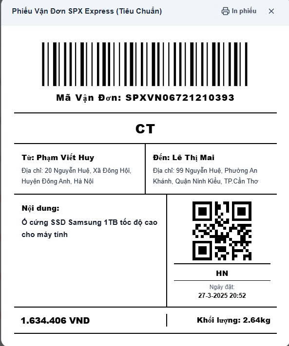
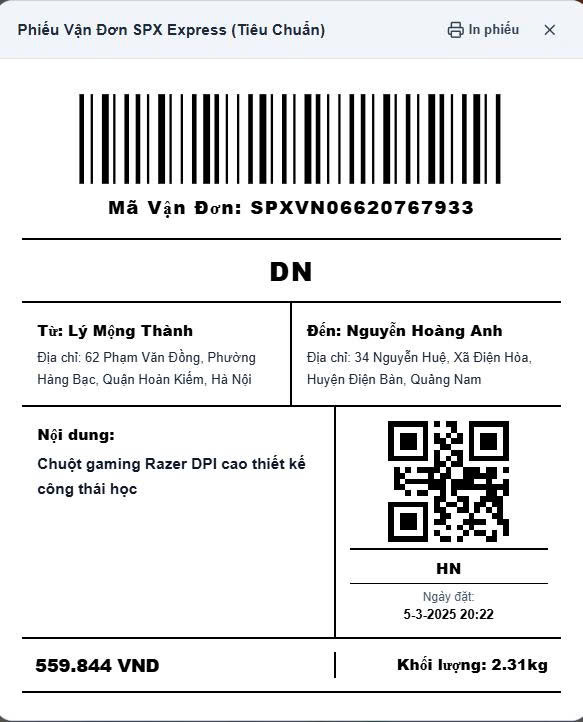
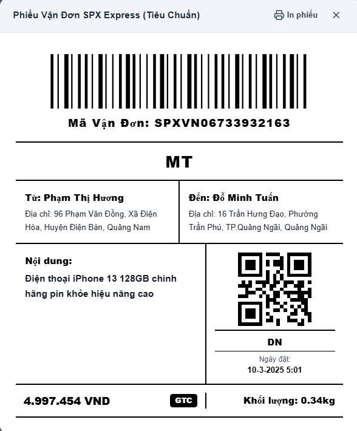
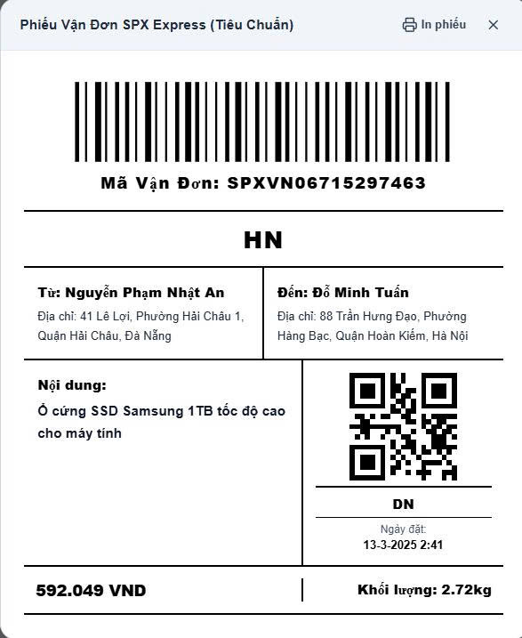
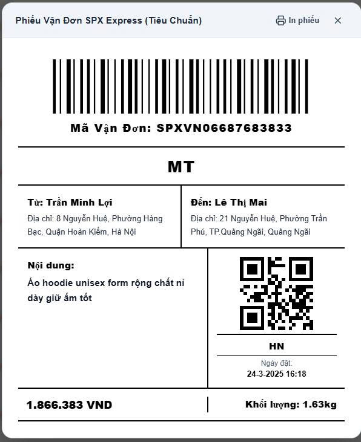
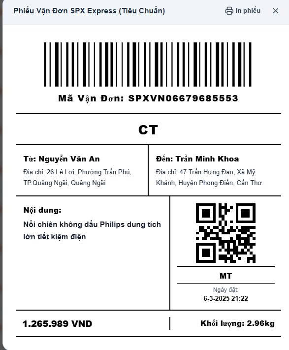
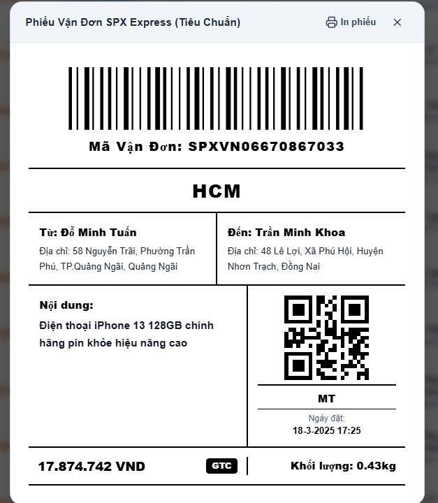

# SPX Express Web Portal (Next.js & React)

Hệ thống Web điều phối & phân loại bưu kiện SPX Express dành cho máy tính để bàn (Desktop / Tablet) tại các Hub / Sorting Center bưu cục.

Được chuyển thể toàn diện từ ứng dụng di động Flutter (`App_Quet_Ma`), dùng chung Backend Node.js Express sẵn có.

---

## 🌐 Đường Dẫn Truy Cập Hệ Thống (Live Deployment)

| Dịch vụ | Nền tảng | URL Trực tuyến |
| :--- | :--- | :--- |
| **SPX Web Portal** | Next.js 14 / Railway | **https://webbasic-production-c870.up.railway.app** |
| **Backend API** | Node.js Express / Railway | **https://webbasic-production-47cd.up.railway.app** |

---

## 📦 Danh Sách Mã Đơn Mẫu & Phiếu In Vận Đơn (Dùng Để Test Hệ Thống)

Người dùng có thể sử dụng các mã vận đơn mẫu và hình ảnh phiếu in dưới đây để thử nghiệm các tính năng **Quét mã vạch (Barcode/QR)**, **Phân loại vào bao TO**, **Tra cứu đơn hàng** và **Kiểm tra luồng Inbound / Outbound**:

| Mã vận đơn (Tracking ID) | Nơi gửi | Nơi nhận (Hub đích) | Khối lượng | Trạng thái mẫu | Phiếu in mẫu |
| :--- | :---: | :---: | :---: | :---: | :---: |
| **`SPXVN06721210393`** | HN | **CT** (Cần Thơ) | 2.64 kg | Inbound | [Xem phiếu](public/sample_bills/SPXVN06721210393.jpg) |
| **`SPXVN06620767933`** | HN | **DN** (Đà Nẵng) | 2.31 kg | Inbound | [Xem phiếu](public/sample_bills/SPXVN06620767933.jpg) |
| **`SPXVN06733932163`** | DN | **MT** (Miền Trung) | 0.34 kg | Outbound | [Xem phiếu](public/sample_bills/SPXVN06733932163.jpg) |
| **`SPXVN06715297463`** | DN | **HN** (Hà Nội) | 2.72 kg | Outbound | [Xem phiếu](public/sample_bills/SPXVN06715297463.jpg) |
| **`SPXVN06687683833`** | HN | **MT** (Miền Trung) | 1.63 kg | Outbound | [Xem phiếu](public/sample_bills/SPXVN06687683833.jpg) |
| **`SPXVN06679685553`** | MT | **CT** (Cần Thơ) | 2.96 kg | Inbound | [Xem phiếu](public/sample_bills/SPXVN06679685553.jpg) |
| **`SPXVN06670867033`** | MT | **HCM** (TP.HCM) | 0.43 kg | Outbound | [Xem phiếu](public/sample_bills/SPXVN06670867033.jpg) |

### 🖼️ Hình Ảnh Phiếu Vận Đơn Mẫu Trực Quan (Scan Test)

<p align="center">
  
  
  
</p>
<p align="center">
  
  
  
</p>
<p align="center">
  
</p>

---

## 🚀 Các Tính Năng Đã Triển Khai & Cập Nhật Mới Nhất

### 1. Quản lý Điều phối & Menu Điều hướng (TO Management & Orders Router)
- **Gộp nhóm TO Management:** Tối ưu thanh điều hướng Menu bên trái; gom hai chức năng chính vào dropdown **TO Management**:
  - `/TOmanagement/sorting`: Trạm phân loại & Gom bao hàng (Landing View chọn mã TO trước khi vào giao diện quét).
  - `/TOmanagement/listTO`: Danh sách quản lý các bao hàng trong kho.
- **Phân hệ Quản lý Đơn hàng (/orders):**
  - `/orders`: Kho toàn bộ đơn hàng tồn kho (Orders Inventory).
  - `/orders/search`: Tra cứu vận đơn nhanh và tra cứu hàng loạt.
  - `/orders/create`: Tạo mới đơn hàng thông minh.

---

### 2. Quản lý Toàn bộ Đơn hàng Trong Kho (/orders - Inventory View)
- **Chuẩn hóa Trạng thái Vận đơn (Inbound vs Outbound):**
  - **`Inbound` (Nhãn xanh lá):** Các đơn đã được quét phân loại và đóng vào bao hàng TO. Cột mã TO hiển thị mã bao tương ứng kèm thời gian đóng bao.
  - **`Outbound` (Nhãn đỏ):** Các đơn hàng vừa tạo mới hoặc chưa đóng vào bao hàng. Cột mã TO để trống.
- **Thuật toán Sắp xếp (Sorting) chuẩn xác tuyệt đối:**
  - **Ưu tiên 1:** Tất cả đơn **`Inbound`** hiển thị lên đầu bảng, sắp xếp theo thời gian đóng bao (`thoiGianDongBao`) mới nhất.
  - **Ưu tiên 2:** Tất cả đơn **`Outbound`** hiển thị ngay sau, sắp xếp theo thời gian tạo đơn (`thoiGianTao`) mới nhất. Các đơn vừa tạo sẽ lập tức hiển thị trên cùng nhóm Outbound ở trang 1.
- **Tối ưu Bảng dữ liệu (Responsive - Không cần scroll ngang):**
  - Gộp cột người gửi và người nhận vào cùng dòng trực quan.
  - Tên các cột ngắn gọn, dễ nhìn: `Khối lượng` -> `kg`, `Tiền thu` -> `cost`, `Thời gian` -> `Time Create`.
  - Thay thế nút "Xem bill" cồng kềnh bằng biểu tượng con mắt (`Eye icon`) sắc nét mở Modal chi tiết.
- **Bộ lọc & Phân trang:** Lọc theo trạng thái Tất cả / Inbound / Outbound, tìm kiếm theo từ khóa theo thời gian thực và phân trang linh hoạt.

---

### 3. Tạo Đơn hàng Thông minh & Cơ chế Chống Trùng Mã (Zero-Collision)
- **Quy chuẩn mã vận đơn SPX Express:**
  - Tự động sinh mã chuẩn: `SPXVN` + `{2 số năm}` + `{8 số ngẫu nhiên}` + `{ký tự tháng: 1-9, A, B, C}`.
- **Cơ chế Tự động Thử lại tại Backend (Backend Auto-Retry):**
  - Tích hợp kiểm soát trùng khóa chính (`ER_DUP_ENTRY` / Error 1062) trực tiếp trên Backend.
  - Nếu mã bị trùng trong Database, Backend tự động sinh mã mới và lưu lại ngay lập tức (tối đa 5 lần lặp ngầm).
  - **Người dùng chỉ cần ấn Tạo đơn 1 lần duy nhất**, loại bỏ hoàn toàn tình trạng báo lỗi bắt tạo lại đơn, triệt tiêu xác suất trùng mã đối với trải nghiệm người dùng về xấp xỉ 0%.
- **Tự động định tuyến Hub vùng (Auto Region Mapping):**
  - Tự động phân tích địa chỉ người nhận bằng thuật toán so khớp Levenshtein (Fuzzy Matching) để ánh xạ về 5 Hub chính: `HN`, `HCM`, `DN`, `CT`, `MT`.

---

### 4. Trạm phân loại & Gom bao Transfer Order (TO Station)
- **Hỗ trợ thiết bị chuyên dụng:**
  - Tương thích tối đa với súng bắn mã vạch Barcode Scanner (bắt sự kiện phím Enter tốc độ cao).
  - Tích hợp quét trực tiếp qua Webcam/Camera máy tính (`html5-qrcode`).
- **Phản hồi âm thanh chuẩn:** Tiếng Beep nhẹ khi quét đúng và âm Buzz cảnh báo lỗi (sai nơi nhận, đơn đã quét, đơn không hợp lệ) qua Web Audio API.
- **Đóng bao & In nhãn:** Niêm phong bao hàng, chốt tải trọng và in nhãn Bill TO tiêu chuẩn.

---

### 5. Danh sách Bao hàng (TO Management - listTO)
- Bảng quản lý tổng thể các bao TO trong kho.
- Xem danh sách chi tiết các gói hàng bên trong bao (đồng bộ real-time từ Database).
- Mở lại bao để quét thêm gói hàng (Reopen TO), xóa bao và in lại nhãn bao hàng.

---

### 6. Tra cứu Vận đơn Hàng loạt (Multi-Order Tracking)
- **Tra cứu hàng loạt (Batch Search):** Hỗ trợ dán đồng thời hàng chục mã vận đơn phân cách bằng dấu cách, phẩy, chấm phẩy hoặc xuống dòng từ Excel/Notepad.
- **Kiểm tra định dạng & tồn tại nghiêm ngặt:** Cảnh báo ngay lập tức nếu có mã sai quy chuẩn hoặc không tồn tại trong hệ thống.
- **Xem Bill theo yêu cầu:** Popup tem bưu kiện chuẩn khổ lớn, hỗ trợ đóng nhanh bằng phím ESC.

---

## ⚙️ Hướng dẫn Khởi chạy Web

### Cài đặt môi trường & Thư viện
```bash
cd App_Web/Web_Quet_Ma
npm install
```

### Chạy ở môi trường Development
```bash
npm run dev
```
Mở trình duyệt tại: `http://localhost:3000`

### Môi trường Production & Kết nối Backend
- Backend API mặc định có thể trỏ tới Localhost hoặc Backend Online Railway:
  `https://webbasic-production-47cd.up.railway.app`
- Cấu hình linh hoạt qua trang **Cài đặt thiết bị** hoặc file `.env.local`:
  ```env
  NEXT_PUBLIC_API_URL=https://webbasic-production-47cd.up.railway.app
  ```
