# Hệ Thống Quản Lý & Phân Loại Bưu Kiện (SPX Express System)

Hệ thống quản lý, điều phối và phân loại bưu kiện chuyên dụng cho bưu cục và trung tâm phân loại (Hub / Sorting Center) theo quy trình logistics tiêu chuẩn SPX Express. 

Hệ thống bao gồm đầy đủ **Ứng dụng di động (Mobile App Flutter)**, **Cổng quản trị web (Web Portal Next.js)** và **Máy chủ dịch vụ (Backend API Node.js)** kết nối cơ sở dữ liệu tập trung.

---


---

## 🌐 Đường Dẫn Trực Tuyến & Thử Nghiệm Hệ Thống (Live Deployment)

| Dịch vụ | Nền tảng | URL Trực tuyến |
| :--- | :--- | :--- |
| **SPX Web Portal** | Next.js 14 / Railway | **https://webbasic-production-c870.up.railway.app** |
| **SPX Backend API** | Node.js Express / Railway | **https://webbasic-production-47cd.up.railway.app** |

---

## 📦 Danh Sách Mã Đơn Mẫu & Phiếu In Vận Đơn (Dùng Test Scan / Tra Cứu)

Dưới đây là các mã đơn mẫu có sẵn trên hệ thống, kèm hình ảnh phiếu bưu kiện (Barcode + QR Code sắc nét) để quét thử nghiệm tính năng **Quét Camera**, **Súng Barcode Scanner**, **Phân loại vào bao TO** và **Tra cứu hàng loạt**:

| Mã vận đơn (Tracking ID) | Nơi gửi | Nơi nhận (Hub đích) | Khối lượng | Trạng thái mẫu | Phiếu in mẫu |
| :--- | :---: | :---: | :---: | :---: | :---: |
| **`SPXVN06721210393`** | HN | **CT** (Cần Thơ) | 2.64 kg | Inbound | [Xem phiếu](public/sample_bills/SPXVN06721210393.jpg) |
| **`SPXVN06620767933`** | HN | **DN** (Đà Nẵng) | 2.31 kg | Inbound | [Xem phiếu](public/sample_bills/SPXVN06620767933.jpg) |
| **`SPXVN06733932163`** | DN | **MT** (Miền Trung) | 0.34 kg | Outbound | [Xem phiếu](public/sample_bills/SPXVN06733932163.jpg) |
| **`SPXVN06715297463`** | DN | **HN** (Hà Nội) | 2.72 kg | Outbound | [Xem phiếu](public/sample_bills/SPXVN06715297463.jpg) |
| **`SPXVN06687683833`** | HN | **MT** (Miền Trung) | 1.63 kg | Outbound | [Xem phiếu](public/sample_bills/SPXVN06687683833.jpg) |
| **`SPXVN06679685553`** | MT | **CT** (Cần Thơ) | 2.96 kg | Inbound | [Xem phiếu](public/sample_bills/SPXVN06679685553.jpg) |
| **`SPXVN06670867033`** | MT | **HCM** (TP.HCM) | 0.43 kg | Outbound | [Xem phiếu](public/sample_bills/SPXVN06670867033.jpg) |

### 🖼️ Hình Ảnh Phiếu Vận Đơn Mẫu Trực Quan (Scan Test)

<p align="center">
  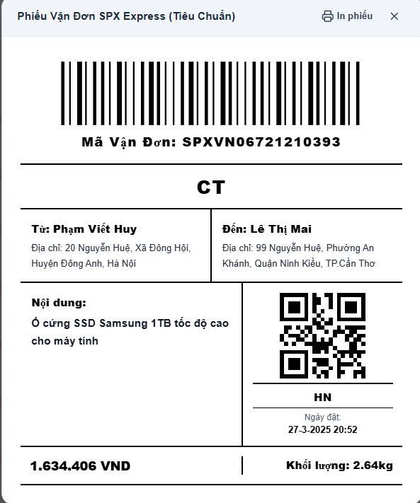
  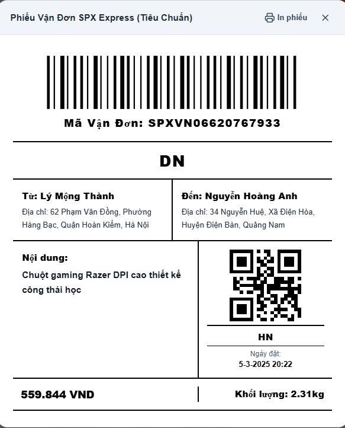
  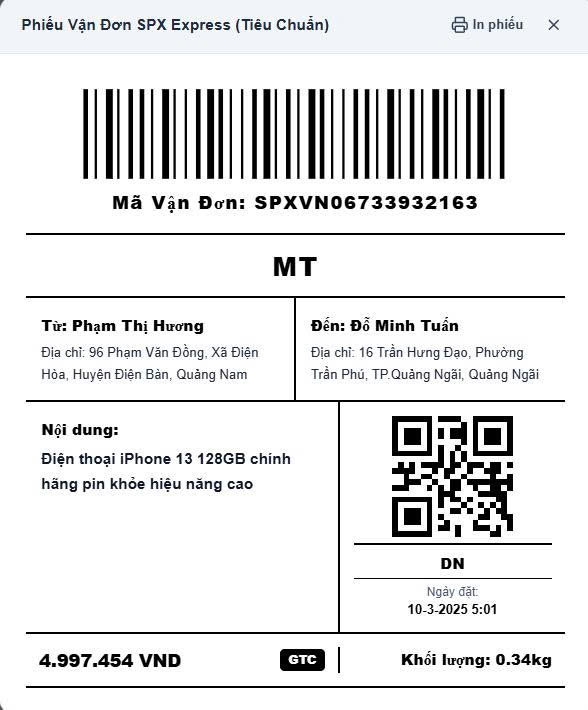
</p>
<p align="center">
  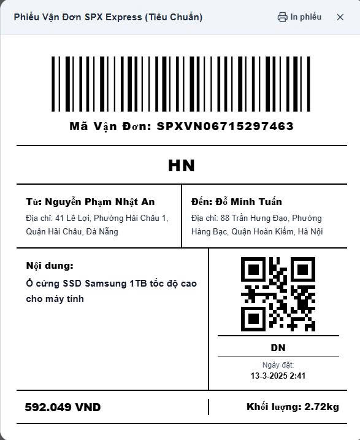
  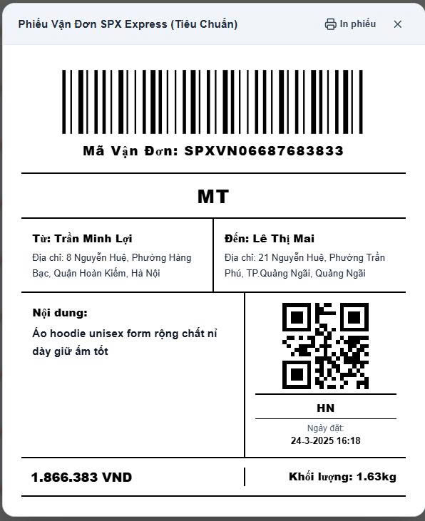
  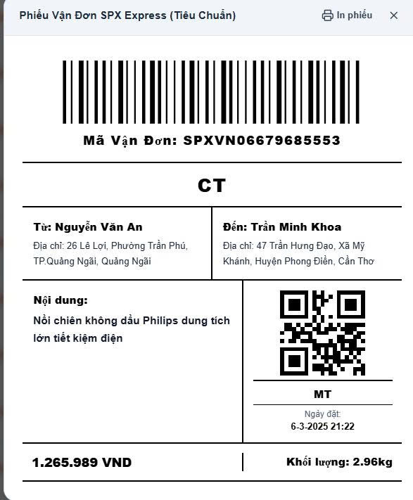
</p>
<p align="center">
  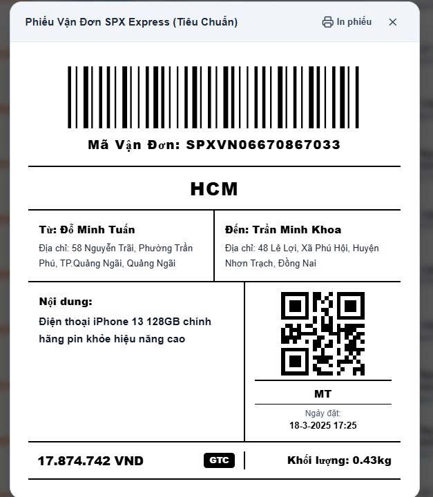
</p>

## 📸 Giao Diện Hệ Thống (UI Screenshots)

| 1. Quản Lý Chuyến Xe Trung Chuyển (Dashboard) | 2. Tạo Chuyến Xe Trung Chuyển |
| :---: | :---: |
| 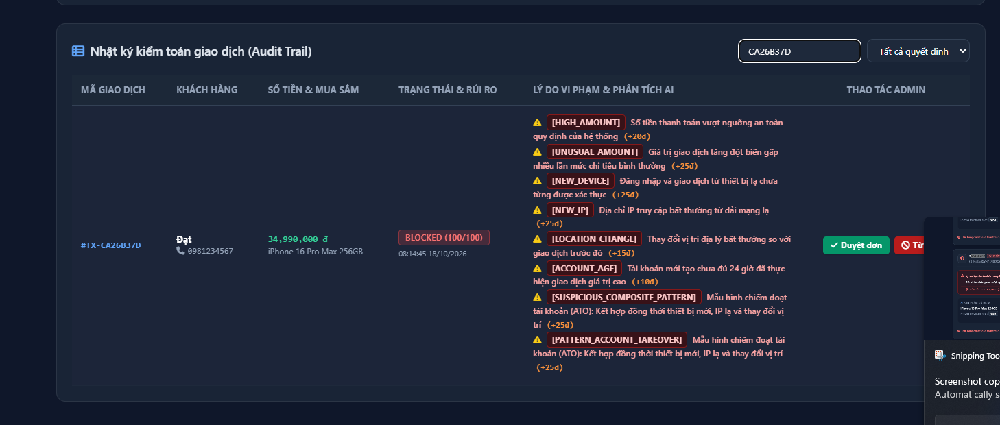 | 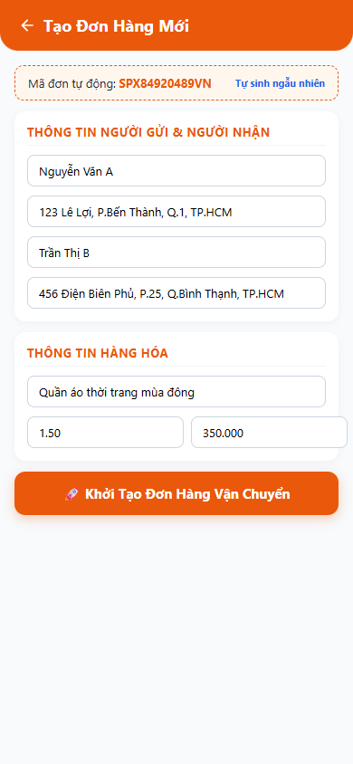 |

| 3. Phân Loại Bao Hàng (TO) | 4. Quản Lý Danh Sách Bao Hàng |
| :---: | :---: |
| 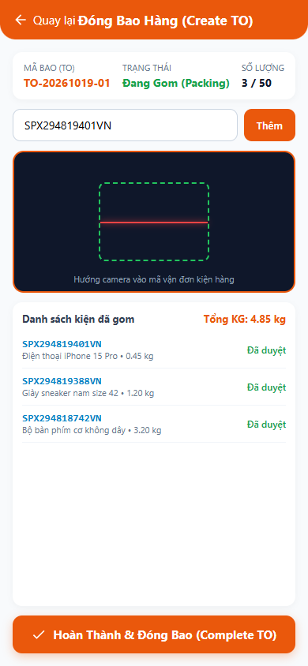 | 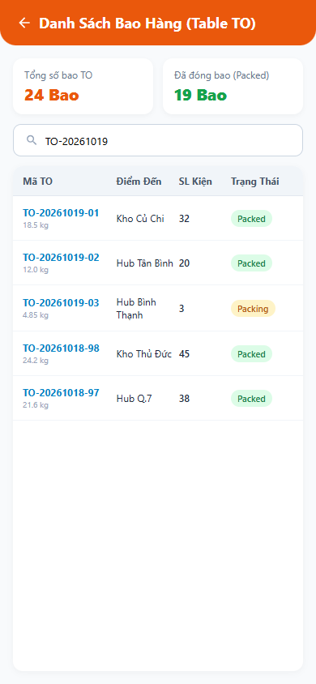 |

| 5. Chi Tiết Kiện Hàng Trong Bao | 6. Tra Cứu Vận Đơn Bưu Kiện |
| :---: | :---: |
| 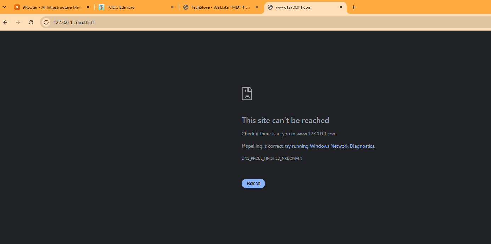 | 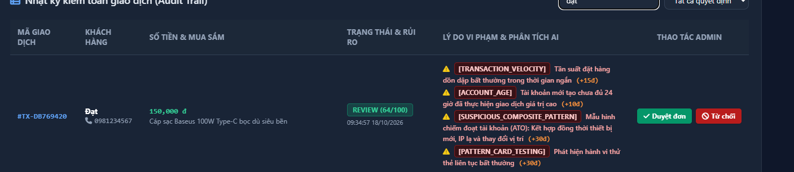 |

---

## 🚀 Các Thành Phần Trong Hệ Thống

### 1. Ứng dụng Di động Mobile (`App_Web/App_Quet_Ma` - Flutter)
Được thiết kế tối ưu cho điện thoại thông minh (Android/iOS) và thiết bị PDA quét mã cầm tay chuyên dụng:
- **Tối ưu hóa Scanner:** Sử dụng `mobile_scanner` quét liên tục với các định dạng mã bưu kiện phổ biến (`Code128`, `QRCode`, `EAN13`, `Code39`). Tắt xử lý frame ảnh thừa (`returnImage: false`), giảm tải CPU/RAM, tăng tốc độ nhận diện.
- **Chống quét trùng & chống lag:** Tích hợp bộ đệm thời gian thực (Debounce 1.5s) và cờ khóa xử lý API, ngăn chặn gọi request dồn dập khi camera chĩa lâu vào mã vạch.
- **Đèn Flash:** Bật/tắt đèn chiếu sáng tức thì ngay trên Header màn hình quét mã trong kho tối.
- **Phản hồi âm thanh không độ trễ:** Sử dụng 2 instance `AudioPlayer` chạy nền với âm thanh beep (thành công) và error buzzer (<50ms).
- **Điều hướng mượt mà, chống đè Stack:**
  - Chuẩn hóa thanh điều hướng `HeaderWidget` hiển thị tiêu đề ngữ cảnh rõ ràng và nút quay lại an toàn với `Navigator.canPop`.
  - Cơ chế `pushReplacement` khi hoàn tất đóng bao (`CreateTOScreen` ➔ `TOResultScreen`) hoặc tạo mới TO, loại bỏ triệt để hiện tượng kẹt trang cũ hay các trang bị chồng đè lên nhau.
  - Đăng xuất an toàn dọn sạch stack với xác nhận người dùng.
- **Chụp ảnh & Chia sẻ phiếu in (Export / Share Bill):** Sử dụng `RenderRepaintBoundary` kết xuất toàn bộ phiếu vận đơn và phiếu bao TO thành file ảnh PNG chất lượng cao (3x resolution) và chia sẻ tức thì qua Zalo, Drive, Gmail hoặc máy in di động thông qua `share_plus`.
- **Nhận diện kiện hàng Giá Trị Cao (GTC):** Tự động phân tích giá trị đơn bưu kiện; các đơn trên 3.000.000 VNĐ sẽ được tự động đóng dấu huy hiệu đen cảnh báo **"GTC"** nổi bật trên nhãn bưu kiện.
- **Hỗ trợ nhập liệu thông minh:**
  - Tự động trích xuất vùng miền / Hub đích từ địa chỉ người gửi và người nhận.
  - Tự động format tiền tệ Việt Nam (`100.000 VND`) và trọng lượng số thập phân (tự điền `0.x` khi gõ bắt đầu bằng dấu chấm `.`).
- **Tính năng đầy đủ:** Quét gom bao TO, kiểm tra trạng thái TO, tra cứu đơn hàng, tạo đơn bưu kiện mới, xem/in phiếu niêm phong, chế độ Dark Mode / Light Mode, đổi mật khẩu & quên mật khẩu.

### 2. Cổng Quản Trị Web Portal (`App_Web/Web_Quet_Ma` - Next.js & React)
Dành cho máy tính văn phòng, trạm máy bàn phân loại (Desktop) hoặc máy tính bảng tại Hub:
- **Công nghệ hiện đại:** Xây dựng trên Next.js 16 (App Router), React 19, TypeScript và Tailwind CSS v4. Hỗ trợ đầy đủ Dark Mode / Light Mode.
- **Điều phối & Quản lý chuyến xe trung chuyển:** 
  - Theo dõi trực quan trạng thái xe (*Chờ bốc hàng ➔ Đang tải hàng ➔ Đang trung chuyển ➔ Hoàn thành*).
  - Wizard tạo chuyến xe chuẩn hóa 4 bước (*1. Thông tin chuyến ➔ 2. Chọn loại xe & tài xế ➔ 3. Gán tải bưu kiện/bao hàng ➔ 4. Xác nhận xuất bến*).
  - Quản lý đội xe trung chuyển đa tải trọng (1.5 tấn, 3.5 tấn, 8 tấn, 15 tấn container).
- **Trạm quét mã phân loại (TO Station):**
  - Tích hợp linh hoạt cả súng bắn mã vạch phần cứng (nhận diện tự động qua phím Enter) lẫn quét trực tiếp qua Webcam/Camera máy tính (`html5-qrcode`).
  - Âm thanh phản hồi trực tiếp bằng Web Audio API không phụ thuộc file ngoài.
  - Hiệu ứng hoàn tất đóng bao sinh động (Confetti) và hỗ trợ in ấn phiếu TO (Print View) trực tiếp từ trình duyệt.
- **Tra cứu vận đơn nâng cao:** Hỗ trợ tra cứu hàng loạt đa định dạng (dấu cách, phẩy, xuống dòng), xác thực định dạng SPX, kiểm tra tồn tại database nghiêm ngặt (chỉ trả về khi tất cả mã hợp lệ và có trong DB), bảng kết quả trực quan tích hợp popup xem Bill/tem vận đơn khổ lớn (hỗ trợ phím ESC).
- **Tạo đơn thông minh:** Tự động sinh mã chuẩn SPX, tự động phân tích địa chỉ để định tuyến Hub gửi/nhận (HN, HCM, DN, CT, MT) theo thuật toán logic, ẩn form sau khi tạo và cung cấp nút copy mã & xem bill nhanh.
- **Cấu hình trạm làm việc:** Dễ dàng đổi URL Backend linh hoạt giữa Localhost và Cloud Railway trực tiếp trên giao diện Settings.
- **Xác thực & Khôi phục tài khoản:** Màn hình đăng nhập bảo mật kèm modal "Quên mật khẩu" hỗ trợ reset trực tiếp về mật khẩu mặc định qua API.

### 3. Máy Chủ Backend API (`Server/server_appQuetMa_nodeJS` - Express)
Cung cấp toàn bộ RESTful API dùng chung cho cả App Mobile và Web:
- **Người dùng (`/`):** 
  - `GET /login/users/:username/:password` & `GET /login/users/:username`: Đăng nhập, xác thực thông tin nhân viên bưu cục.
  - `PUT /repass/users/:username`: Khôi phục / đặt lại mật khẩu cho tài khoản.
- **Bưu kiện (`/orders`):**
  - `GET /orders/getIn4`: Tra cứu chi tiết theo ID bưu kiện, lấy danh sách phân trang (Pagination 10 đơn/trang), lọc theo trạng thái (`Inbound`, `Outbound`), tìm kiếm theo từ khóa.
  - `POST /orders`: Tạo đơn bưu kiện mới vào hệ thống.
  - `POST /orders/scan/:id`: Quét nạp bưu kiện vào bao hàng TO, tự động cộng dồn khối lượng và cập nhật trạng thái đơn thành `Inbound`.
  - `POST /orders/remove/:id`: Xóa bưu kiện khỏi bao TO, tự động trừ khối lượng và hoàn trả trạng thái ban đầu của kiện hàng.
- **Bao hàng Transfer Order (`/TO`):**
  - `GET /TO`: Lấy toàn bộ danh sách bao hàng hoặc lọc theo trạng thái.
  - `GET /TO?maTO=...`: Truy xuất thông tin chi tiết và danh sách tất cả kiện hàng nằm trong bao.
  - `POST /TO`: Khởi tạo bao hàng TO mới với điểm đến (Hub đích).
  - `PUT /TO/:maTO`: Đóng niêm phong bao hàng, cập nhật trạng thái hoàn thành (`Packed`).
  - `PUT /TO/:maTO/reopen`: Mở lại bao hàng đã niêm phong để tiếp tục nạp thêm hoặc sửa đổi bưu kiện.
  - `DELETE /TO/:maTO`: Xóa bao hàng khỏi hệ thống.
- **Cấu hình môi trường:** Tự động lắng nghe cổng cấu hình qua biến môi trường `process.env.PORT` (hỗ trợ triển khai Railway, Render, VPS) hoặc mặc định `3000`.

### 4. Cơ Sở Dữ Liệu (`Database/`)
- Lưu trữ tập trung bằng MySQL/MariaDB với 3 schema bảng chuẩn:
  - `users.sql`: Bảng tài khoản nhân viên, mật khẩu và thời gian tạo.
  - `orders.sql`: Bảng bưu kiện, thông tin người gửi/nhận, địa chỉ, giá trị, khối lượng, mã bao TO liên kết, trạng thái vận chuyển.
  - `TO_orders.sql`: Bảng quản lý bao hàng trung chuyển, trạm đích, packer phụ trách, khối lượng tổng và mốc thời gian niêm phong.
- Hỗ trợ lưu trữ offline SQLite cục bộ (`orders_db.db`) trên ứng dụng di động khi mất kết nối mạng.

---

## 🔑 Tài Khoản Thử Nghiệm Mẫu (Demo Credentials)

Bạn có thể sử dụng các tài khoản có sẵn trong cơ sở dữ liệu mẫu để đăng nhập và trải nghiệm:

| Tài khoản (Username) | Mật khẩu (Password) | Vai trò / Ghi chú |
| :--- | :--- | :--- |
| **admin** | `123456` | Quản trị viên / Toàn quyền hệ thống |
| **Tu** | `123456` | Nhân viên bưu cục (Operator) |
| **a** | `123456` | Tài khoản kiểm thử nhanh |

---

## 🛠️ Công Nghệ Sử Dụng

| Thành phần | Công nghệ chính |
| :--- | :--- |
| **Mobile App** | Flutter (Dart 3), Material Design, `mobile_scanner`, `audioplayers`, `share_plus`, `path_provider`, `sqflite`, `http`, `shared_preferences` |
| **Web Portal** | Next.js 16 (App Router), React 19, TypeScript, Tailwind CSS v4, `html5-qrcode`, `lucide-react`, `canvas-confetti`, Web Audio API |
| **Backend API** | Node.js, Express.js (v5), MySQL2, CORS |
| **Database** | MySQL / MariaDB, SQLite offline cache |
| **Testing Tools**| Python 3 (`random_SPX.py` sinh mã vận đơn kiểm thử ngẫu nhiên dạng `SPX...`) |

---

## 📂 Cấu Trúc Thư Mục

```
App_Web_Quet_Ma/
├── App_Web/
│   ├── App_Quet_Ma/               # Mã nguồn ứng dụng Flutter (Mobile Android/iOS)
│   │   ├── assets/                # Âm thanh phản hồi (beep/error), SQLite db, icon
│   │   └── lib/
│   │       ├── BILL/              # Màn hình hóa đơn & chia sẻ phiếu bưu kiện (BillScreen, BillTo)
│   │       ├── data/              # Service gọi API Backend (api_service.dart)
│   │       ├── Login/             # Giao diện đăng nhập & quên mật khẩu
│   │       ├── models/            # Model dữ liệu (Orders, TO, AppBar header logo)
│   │       ├── PhanLoai/          # Phân loại bao hàng (Create TO, Scan TO, Danh sách TO)
│   │       ├── QuanLy/            # Module quản lý đơn hàng & xuất bến
│   │       ├── Setting/           # Cấu hình giao diện, dark/light theme và tài khoản
│   │       ├── TaoDon/            # Tạo đơn bưu kiện mới (tự trích xuất Hub, format tiền/ký)
│   │       ├── TraCuu/            # Tra cứu thông tin vận đơn
│   │       └── main.dart          # Entry point của ứng dụng Mobile
│   └── Web_Quet_Ma/               # Mã nguồn cổng quản trị Web Portal (Next.js & React)
│       ├── public/                # Tài nguyên tĩnh
│       └── src/
│           ├── app/               # Định tuyến trang (Dashboard, Sorting, Orders, Tracking...)
│           ├── components/        # UI components (Header, Sidebar, CameraScanner, BillModal, TripWizard...)
│           ├── context/           # State quản trị chuyến xe, theme và cấu hình trạm
│           ├── lib/               # Service gọi API và Web Audio
│           └── types/             # Định nghĩa kiểu dữ liệu TypeScript
├── Database/                      # Kịch bản cơ sở dữ liệu MySQL (orders.sql, TO_orders.sql, users.sql)
├── Server/
│   └── server_appQuetMa_nodeJS/   # Máy chủ Backend Node.js Express
│       ├── routers/               # Định tuyến API (orders, TO_Orders, users)
│       ├── db.js                  # Cấu hình kết nối MySQL
│       └── server.js              # Entry point Express Server
├── screenshots/                   # Hình ảnh giao diện ứng dụng
├── random_SPX.py                  # Script Python sinh dữ liệu kiểm thử
└── README.md                      # Tài liệu tổng quan dự án
```

---

## ⚙️ Hướng Dẫn Cài Đặt & Khởi Chạy

### 1. Khởi động Backend Node.js
```bash
cd Server/server_appQuetMa_nodeJS
npm install
npm start
```
*Server chạy mặc định tại:* `http://localhost:3000` (hoặc cổng được chỉ định qua biến môi trường `PORT`).

### 2. Khởi chạy Cổng Web Portal (Next.js)
```bash
cd App_Web/Web_Quet_Ma
npm install
npm run dev
```
*Truy cập giao diện Web tại:* `http://localhost:3001` (hoặc cổng được hiển thị trong terminal).

### 3. Khởi chạy Ứng dụng Di Động (Flutter)
```bash
cd App_Web/App_Quet_Ma
flutter pub get

# Chạy trên thiết bị kết nối / máy ảo:
flutter run

# Hoặc xuất file cài đặt APK cho điện thoại Android:
flutter build apk --release
```

### 4. Sinh dữ liệu bưu kiện kiểm thử (Tùy chọn)
```bash
python random_SPX.py
```
