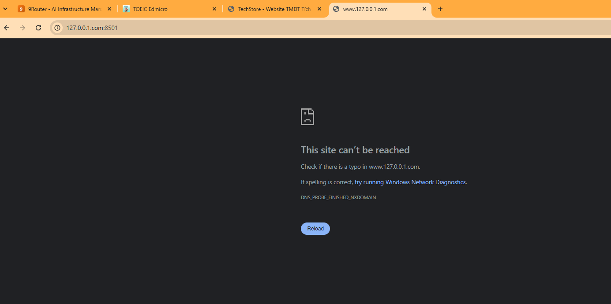
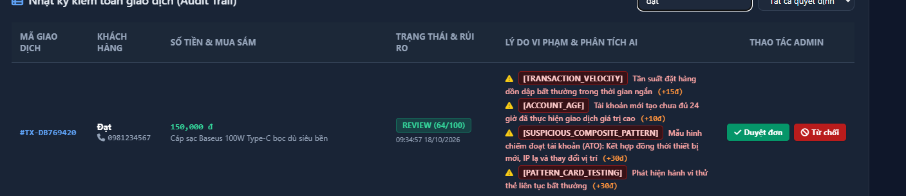

# Hệ Thống Quản Lý & Phân Loại Bưu Kiện (SPX Express Scanner System)

Hệ thống ứng dụng di động và máy chủ hỗ trợ bưu cục / trung tâm phân loại hàng hóa (Hub / Sorting Center) thực hiện quét mã barcode/QR bưu kiện, gom nhóm bao hàng vận chuyển (Transfer Order - TO), tra cứu vận đơn và quản lý chu trình giao nhận theo quy trình tiêu chuẩn logistics (SPX Express).

---

## 📸 Giao Diện Ứng Dụng (UI Screenshots)

| 1. Menu Điều Hành Nghiệp Vụ | 2. Phân Loại Bao Hàng (TO) |
| :---: | :---: |
|  |  |

| 3. Quản Lý Danh Sách Bao Hàng | 4. Chi Tiết Kiện Hàng Trong Bao |
| :---: | :---: |
|  |  |

| 5. Tra Cứu Vận Đơn Bưu Kiện |
| :---: |
|  |

---

## 🚀 Tính Năng Chính

1. **Đăng nhập & Phân quyền nhân viên:**
   - Xác thực tài khoản nhân viên bưu cục và kho hàng.
2. **Phân loại bao hàng (Transfer Order - TO):**
   - Khởi tạo mã bao hàng TO mới với điểm đến (Hub đích).
   - Quét mã vạch đơn hàng liên tục bằng camera hoặc đầu đọc chuyên dụng.
   - Tự động kiểm tra tính hợp lệ và cập nhật số lượng kiện vào bao.
   - Cảnh báo âm thanh (Beep khi thành công, Error khi quét trùng mã hoặc lỗi).
   - Đóng bao niêm phong và in/xuất phiếu thông tin bao hàng (Bill TO).
3. **Quản lý danh sách TO:**
   - Theo dõi trạng thái toàn bộ bao hàng (Đang gom hàng, Đã đóng bao, Đã xuất kho).
   - Xem tổng số kiện, khối lượng và thời gian tạo từng bao.
4. **Tra cứu đơn hàng (Tracking & Lookup):**
   - Quét nhanh mã vận đơn để truy xuất chi tiết thông tin đơn hàng, địa chỉ giao nhận, trạng thái vận chuyển.
5. **Tạo đơn hàng & Quản lý vận đơn:**
   - Thêm đơn mới vào hệ thống trực tiếp từ bưu cục.
   - Hỗ trợ lưu trữ offline SQLite (`orders_db.db`) khi mất kết nối mạng.
6. **Công cụ sinh dữ liệu kiểm thử (Mock Generator):**
   - Script Python `random_SPX.py` tự động sinh mã vận đơn SPX mẫu để kiểm thử quét mã thực tế.

---

## 🛠️ Công Nghệ Sử Dụng

- **Frontend Mobile:** Flutter (Dart), Material Design, `mobile_scanner`, `audioplayers`, `sqflite`, `http`.
- **Backend API:** Node.js Express Server (`server_appQuetMa_nodeJS`), kiến trúc Router & Controllers.
- **Cơ sở dữ liệu:** MySQL / MariaDB (`orders.sql`, `TO_orders.sql`, `users.sql`) & SQLite local database.
- **Tiện ích kiểm thử:** Python (`random_SPX.py`).

---

## 📂 Cấu Trúc Thư Mục

```
App_Web_Quet_Ma/
├── App_Web/
│   └── App_Quet_Ma/               # Mã nguồn ứng dụng di động Flutter
│       ├── assets/                # Âm thanh phản hồi (beep/error), db offline, icon
│       └── lib/
│           ├── BILL/              # Màn hình hóa đơn bao hàng (BillScreen, BillTo)
│           ├── data/              # Service gọi API Backend (api_service.dart)
│           ├── Login/             # Giao diện đăng nhập hệ thống
│           ├── models/            # Model dữ liệu (Orders, TO, AppBar)
│           ├── PhanLoai/          # Module phân loại bao hàng (Tạo TO, Quét mã TO, Danh sách TO)
│           ├── QuanLy/            # Module quản lý đơn hàng
│           ├── Setting/           # Cấu hình scanner và âm thanh
│           ├── TaoDon/            # Tạo đơn vận chuyển mới
│           ├── TraCuu/            # Tra cứu thông tin vận đơn
│           └── main.dart          # Entry point của ứng dụng
├── Database/                      # Kịch bản cơ sở dữ liệu MySQL (orders.sql, TO_orders.sql...)
├── Server/
│   └── server_appQuetMa_nodeJS/   # Máy chủ Backend Node.js Express
│       ├── db.js                  # Cấu hình kết nối MySQL
│       └── server.js              # Định nghĩa API endpoints
├── screenshots/                   # Hình ảnh giao diện ứng dụng
├── random_SPX.py                  # Script Python sinh dữ liệu kiểm thử
└── README.md                      # Tài liệu dự án
```

---

## ⚙️ Hướng Dẫn Cài Đặt & Chạy

### 1. Khởi động Backend Node.js
```bash
cd Server/server_appQuetMa_nodeJS
npm install
npm start
```

### 2. Khởi chạy Ứng dụng Flutter
```bash
cd App_Web/App_Quet_Ma
flutter pub get
flutter run
```

### 3. Sinh dữ liệu test mã SPX (tùy chọn)
```bash
python random_SPX.py
```
