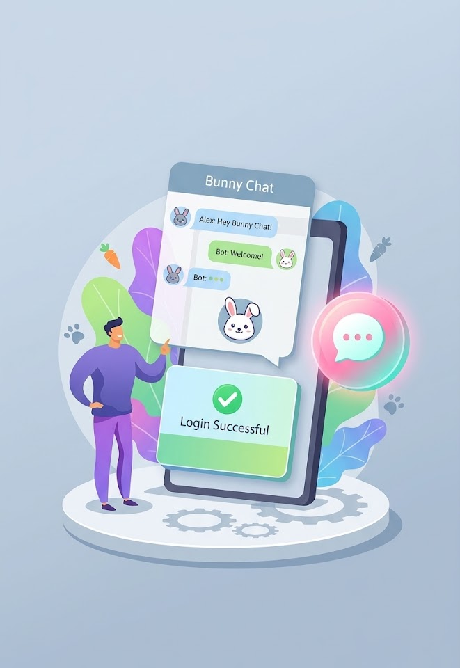
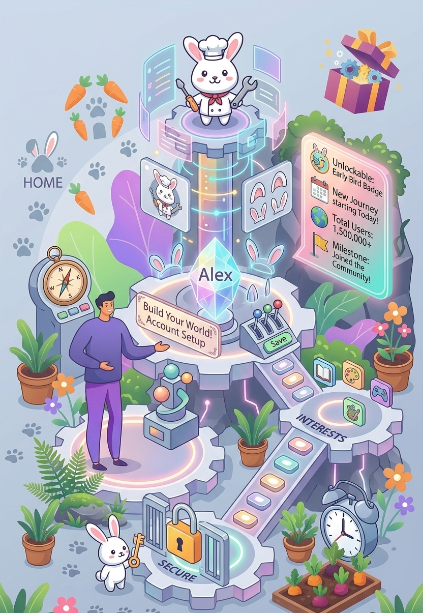
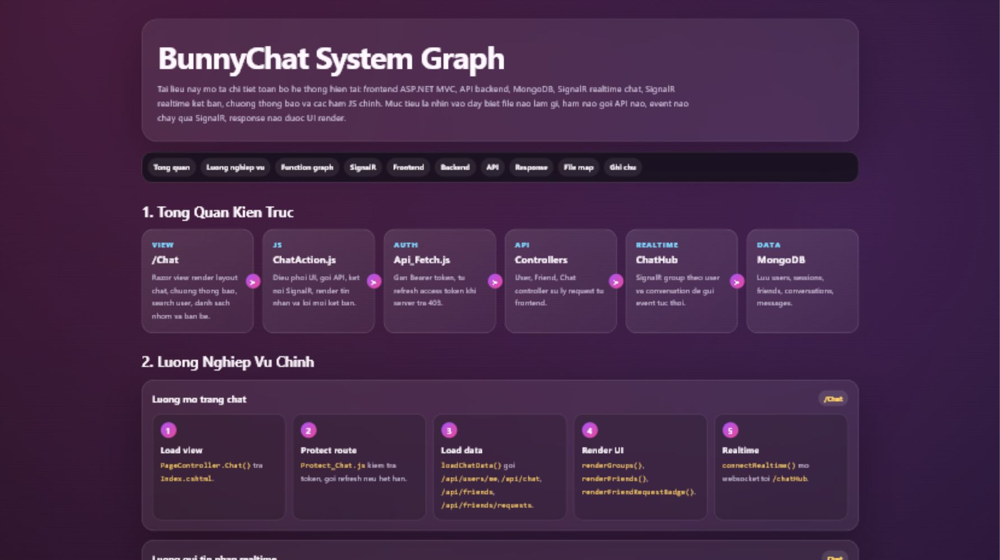
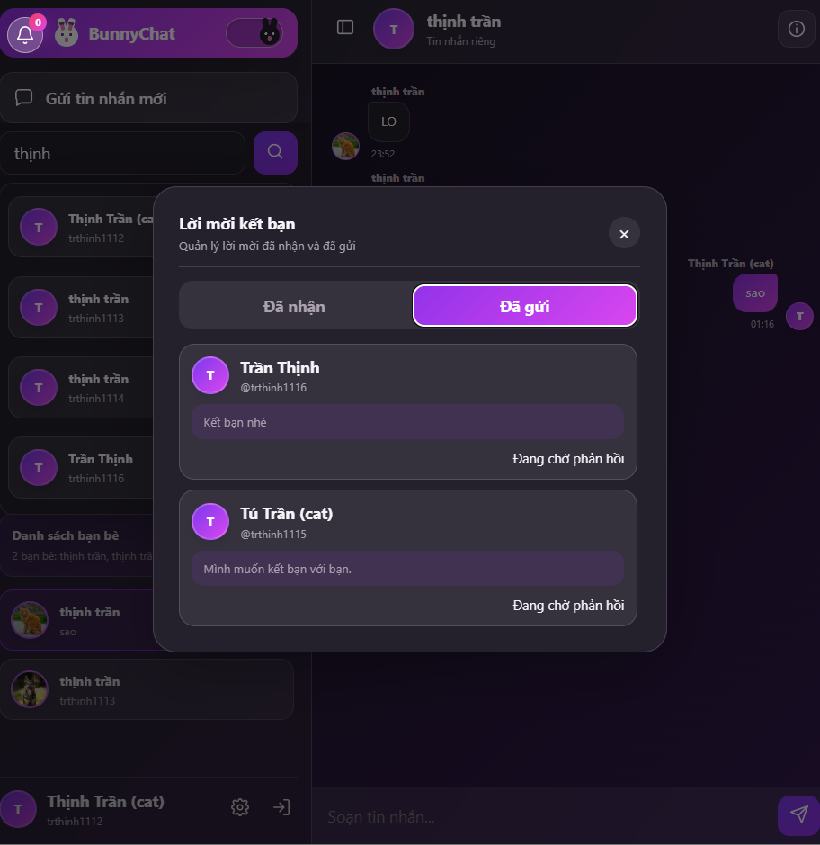
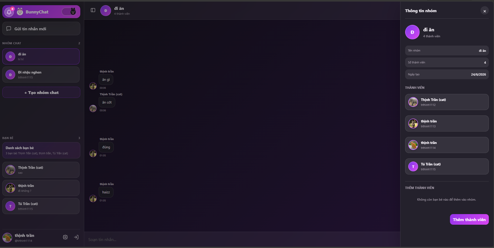
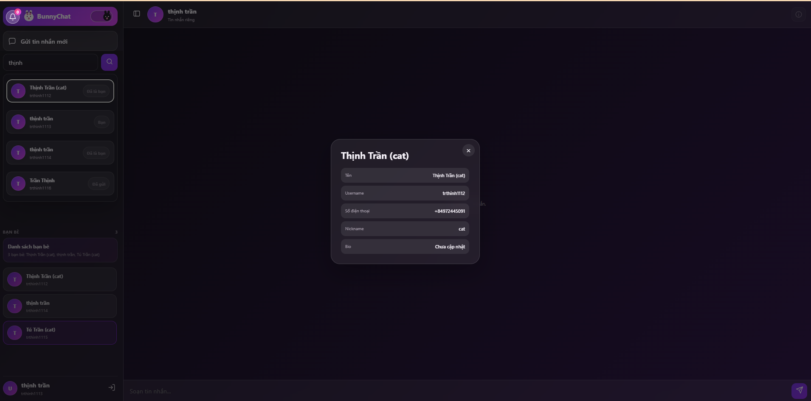
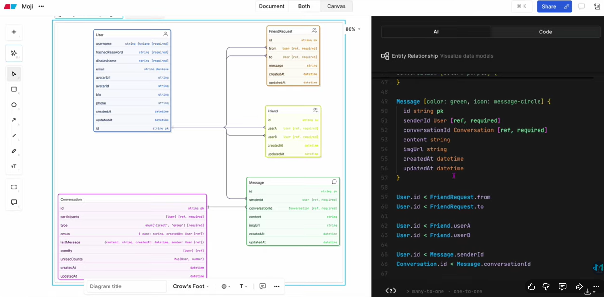

# BunnyChat - Nền Tảng Trò Chuyện Trực Tuyến Thời Gian Thực (Realtime Chat)

BunnyChat là hệ thống ứng dụng nhắn tin trực tuyến thời gian thực hiện đại, được xây dựng trên nền tảng ASP.NET Core kết hợp SignalR và cơ sở dữ liệu NoSQL MongoDB Atlas. Hệ thống cung cấp trải nghiệm chat mượt mà, hỗ trợ giao diện Dark/Light mode, xác thực bảo mật và quản lý bạn bè linh hoạt.

---

## 📸 Giao Diện Ứng Dụng (UI Screenshots)

| 1. Giao Diện Chat (Dark Mode) | 2. Giao Diện Chat (Light Mode) |
| :---: | :---: |
|  |  |

| 3. Trang Đăng Nhập | 4. Trang Đăng Ký |
| :---: | :---: |
|  |  |

| 5. Cuộc Trò Chuyện Trực Tiếp (1-1) | 6. Trò Chuyện Nhóm (Group Chat) |
| :---: | :---: |
|  |  |

| 7. Tìm Kiếm Người Dùng | 8. Quản Lý Lời Mời Kết Bạn |
| :---: | :---: |
|  |  |

| 9. Tạo Nhóm Chat Mới | 10. Sơ Đồ Cơ Sở Dữ Liệu (ERD) |
| :---: | :---: |
|  |  |

---

## 🚀 Tính Năng Chính

1. **Xác thực & Bảo mật phiên (Authentication & Session Security):**
   - Đăng ký, đăng nhập tài khoản với mã hóa mật khẩu an toàn.
   - Cơ chế xác thực kép: Middleware xác thực JWT Access Token kết hợp kiểm tra trạng thái Session trong MongoDB.
   - Tự động thu hồi phiên đăng nhập khi người dùng đăng xuất hoặc hết hạn.
2. **Giao diện hiện đại & Chủ đề (Theme Support):**
   - Hỗ trợ chuyển đổi nhanh giữa **Dark Mode** và **Light Mode**.
   - Thiết kế giao diện phản hồi mượt mà, tối ưu trên nhiều kích thước màn hình.
3. **Nhắn tin thời gian thực (Realtime Messaging with SignalR):**
   - Chat trực tiếp 1-1 giữa 2 người dùng với độ trễ tối thiểu.
   - Trạng thái tin nhắn tức thời, hiển thị thời gian gửi và lịch sử trò chuyện.
4. **Chat nhóm (Group Chat):**
   - Khởi tạo phòng chat nhóm, tùy chỉnh tên nhóm và ảnh đại diện.
   - Thêm/xóa thành viên trong nhóm, xem danh sách người tham gia.
   - Phát tin nhắn realtime đến tất cả thành viên trong nhóm qua SignalR Groups.
5. **Mạng lưới bạn bè (Friend System):**
   - Tìm kiếm người dùng theo tên hoặc email.
   - Gửi lời mời kết bạn, chấp nhận hoặc từ chối yêu cầu kết bạn.
   - Quản lý danh sách bạn bè đã kết nối và trạng thái online/offline.
6. **Sẵn sàng triển khai Container & Đám mây:**
   - Đã cấu hình sẵn `Dockerfile`, `railway.json`, `nixpacks.toml` để triển khai tức thì lên Railway.

---

## 🛠️ Công Nghệ Sử Dụng

- **Backend:** ASP.NET Core (.NET 8/10), C#, ASP.NET Core Web API, SignalR Hub.
- **Frontend:** ASP.NET Core MVC (Razor Views), HTML5, CSS3, JavaScript thuần (Vanilla JS), Bootstrap.
- **Cơ sở dữ liệu:** MongoDB NoSQL (MongoDB Atlas Cloud Database).
- **Triển khai & DevOps:** Docker, Railway, Nixpacks.

---

## 📂 Cấu Trúc Thư Mục

```
BunnyChat/
├── BunnyChat/                     # Thư mục mã nguồn chính của ứng dụng
│   ├── Controllers/               # Web API & MVC Controllers (Auth, Chat, Friend, Group)
│   ├── Hubs/                      # SignalR ChatHub quản lý kết nối realtime
│   ├── Models/                    # Data models (User, Message, Conversation, FriendRequest)
│   ├── Services/                  # Business Logic & Database Services
│   ├── Views/                     # Razor Views cho giao diện người dùng
│   ├── wwwroot/                   # Static assets (CSS, JS, images, sounds)
│   └── Program.cs                 # Cấu hình dependency injection, middleware và SignalR
├── screenshots/                   # Hình ảnh giao diện thực tế của ứng dụng
├── ERD.png                        # Sơ đồ thực thể cơ sở dữ liệu MongoDB
├── Dockerfile                     # Docker container configuration
├── railway.json                   # Cấu hình triển khai Railway
└── README.md
```

---

## ⚙️ Hướng Dẫn Cài Đặt & Chạy

### 1. Chuẩn bị môi trường
- Cài đặt [.NET 8.0 SDK](https://dotnet.microsoft.com/download) hoặc cao hơn.
- Cấu hình chuỗi kết nối MongoDB trong `appsettings.json` hoặc biến môi trường:
```json
"MongoDBSettings": {
  "ConnectionString": "mongodb+srv://<username>:<password>@cluster0.mongodb.net/chatapp",
  "DatabaseName": "chatapp"
}
```

### 2. Biên dịch và khởi chạy
```bash
cd BunnyChat/BunnyChat
dotnet restore
dotnet build
dotnet run
```
Truy cập trình duyệt tại: `http://localhost:5000` (hoặc cổng được hiển thị trong terminal).
