# BunnyChat - Nền Tảng Trò Chuyện Trực Tuyến Thời Gian Thực (Realtime Chat)

BunnyChat là hệ thống ứng dụng nhắn tin trực tuyến thời gian thực hiện đại, được xây dựng trên nền tảng ASP.NET Core kết hợp SignalR và cơ sở dữ liệu NoSQL MongoDB Atlas. Hệ thống cung cấp trải nghiệm chat mượt mà, hỗ trợ giao diện Dark/Light mode, xác thực bảo mật và quản lý bạn bè linh hoạt.

---

## 📸 Giao Diện Ứng Dụng (UI Screenshots)

| 1. Giao Diện Chat (Dark Mode) | 2. Giao Diện Chat (Light Mode) |
| :---: | :---: |
| 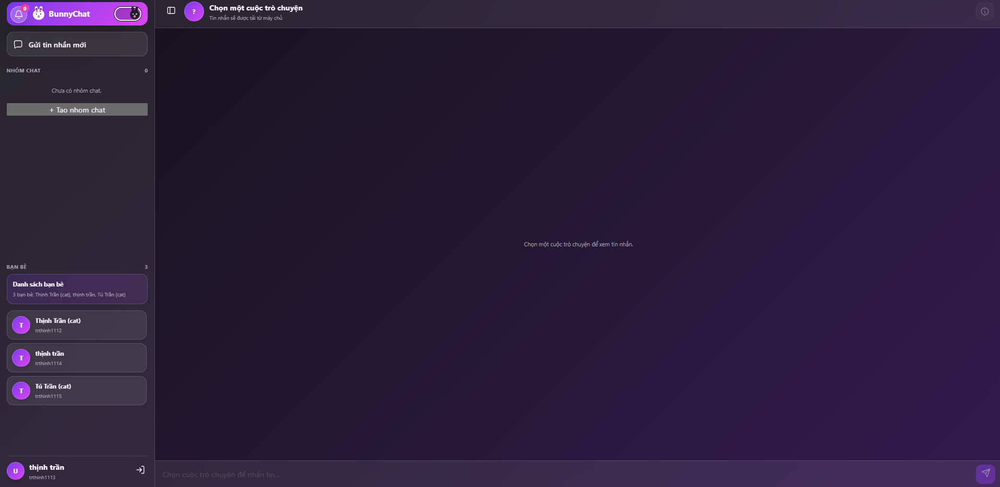 | 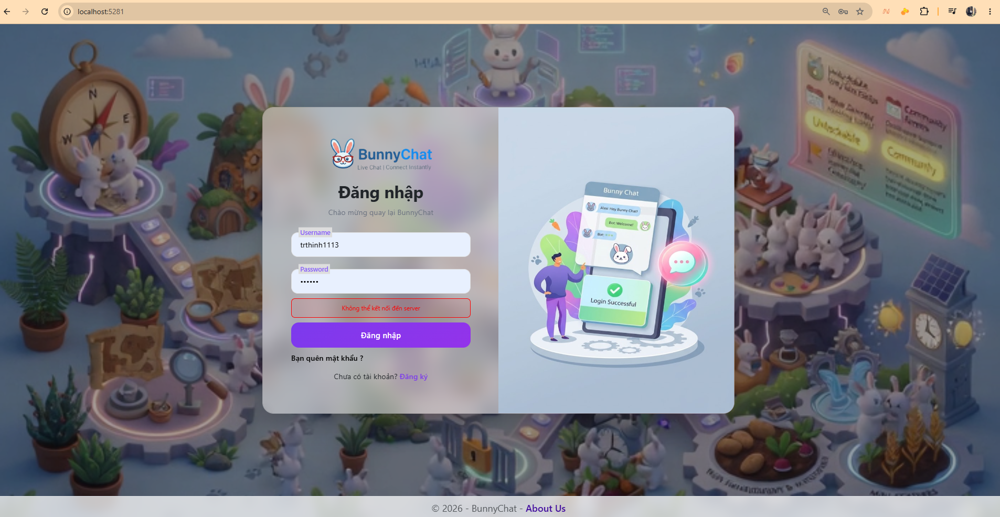 |

| 3. Trang Đăng Nhập | 4. Trang Đăng Ký |
| :---: | :---: |
| 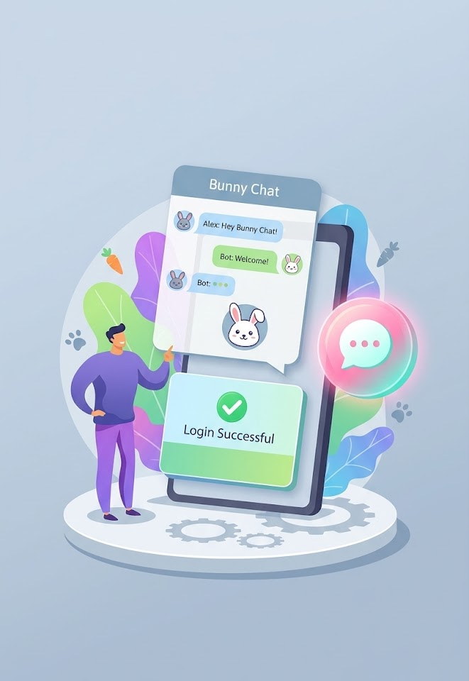 | 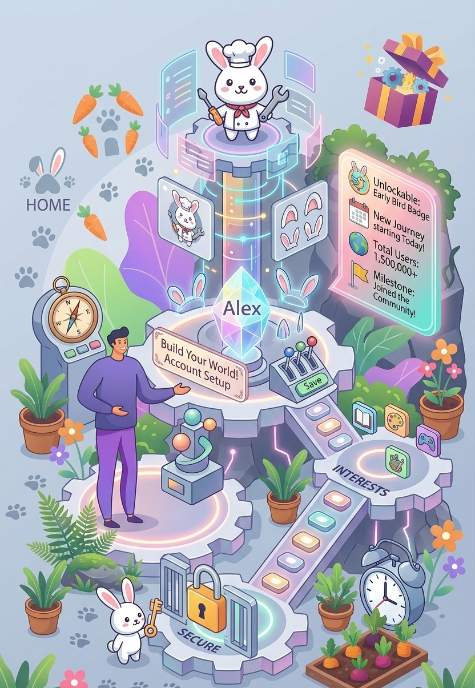 |

| 5. Cuộc Trò Chuyện Trực Tiếp (1-1) | 6. Trò Chuyện Nhóm (Group Chat) |
| :---: | :---: |
| 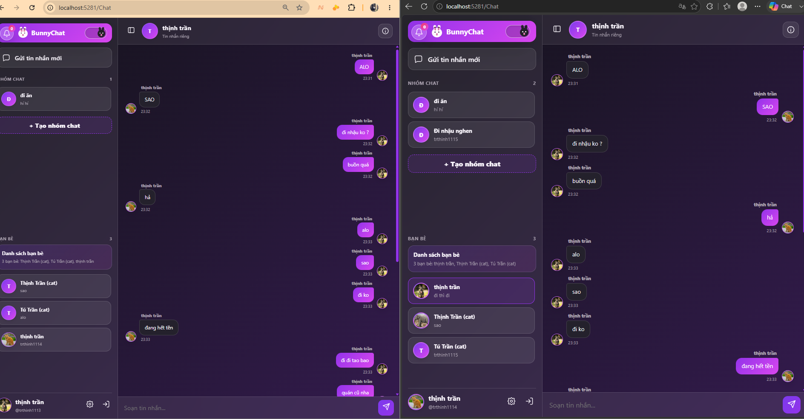 | 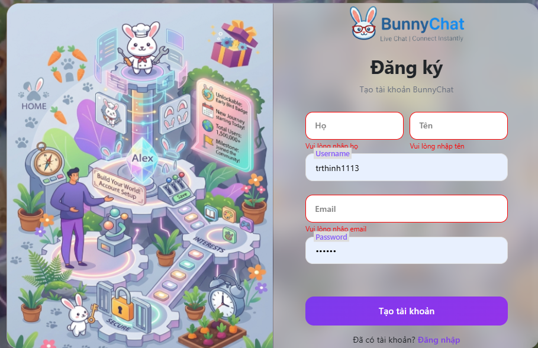 |

| 7. Tìm Kiếm Người Dùng | 8. Quản Lý Lời Mời Kết Bạn |
| :---: | :---: |
| 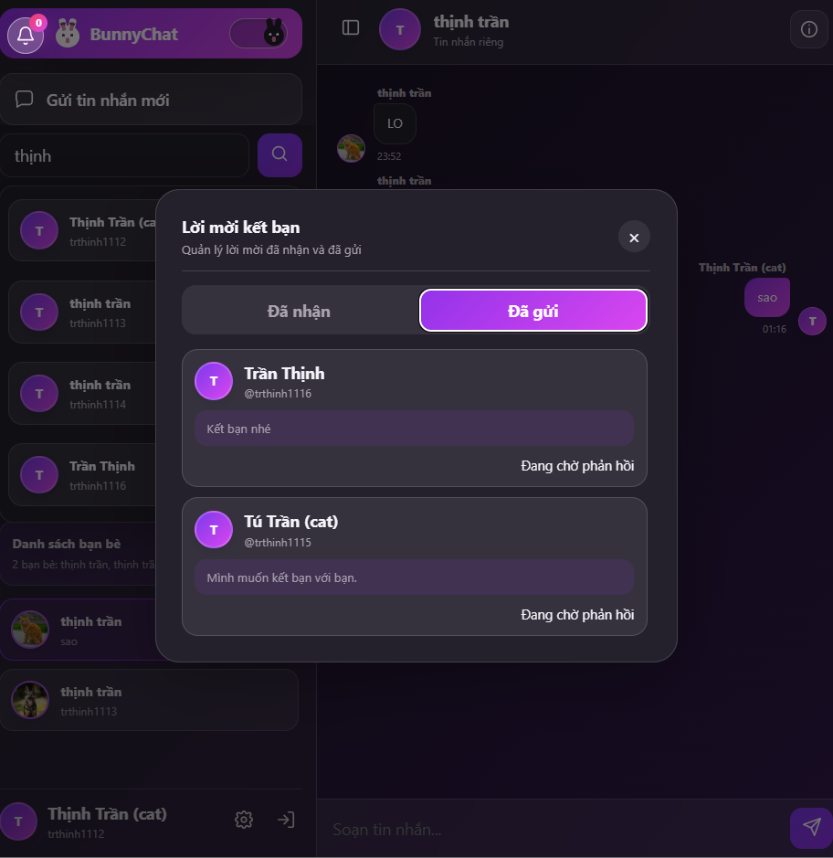 | 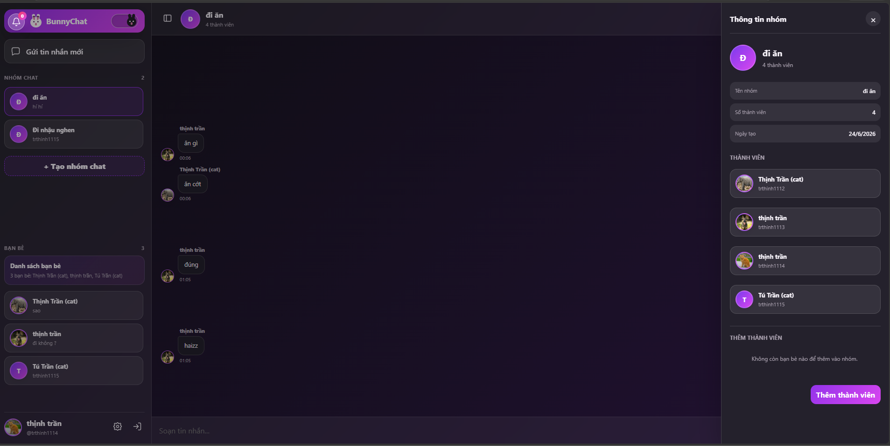 |

| 9. Tạo Nhóm Chat Mới | 10. Trò Chuyện Realtime Giữa 2 Người Dùng |
| :---: | :---: |
| 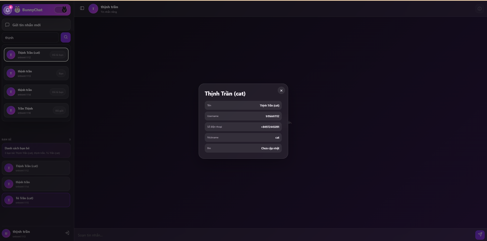 | 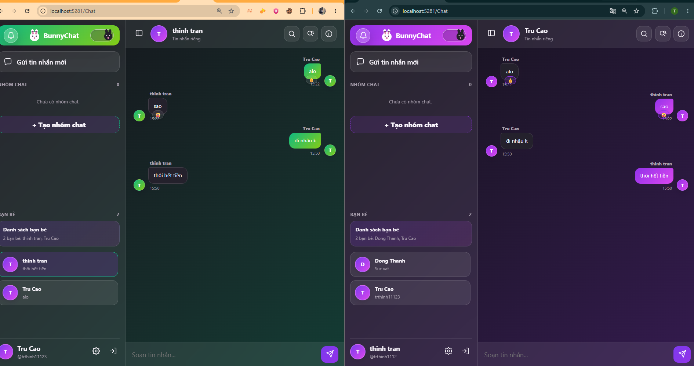<br>*(Cuộc trò chuyện trực tiếp 1-1 giữa 2 tài khoản: gửi nhận tin nhắn thời gian thực qua SignalR và tương tác thả cảm xúc)* |

---

## 📐 Kiến Trúc Hệ Thống & Sơ Đồ Dữ Liệu

### 3.3.1. Sơ đồ kiến trúc tổng quan (Architecture Overview)

Mô hình kiến trúc tổng quan của hệ thống Bunny Chat được thiết kế theo dạng đa tầng (multi-tier), phân chia rõ ràng trách nhiệm giữa tầng hiển thị, truyền thông, nghiệp vụ và lưu trữ dữ liệu, cụ thể được minh họa tại Hình 3.1 dưới đây:

- **Client Tier (Tầng ứng dụng người dùng)**: Ứng dụng di động Flutter (iOS/Android) đóng vai trò là giao diện tương tác người dùng, cung cấp các tính năng nhắn tin, gọi thoại, gửi file, v.v.
- **Communication Layer (Tầng truyền thông)**: Sử dụng giao thức WebSockets (STOMP) để trao đổi tin nhắn hai chiều theo thời gian thực (real-time), kết hợp với RESTful APIs qua HTTPS cho các tác vụ nghiệp vụ như xác thực, tải file, quản lý người dùng.
- **API Gateway & Load Balancer**: Đóng vai trò là điểm đón nhận duy nhất cho toàn bộ các yêu cầu từ Client, thực hiện định tuyến, cân bằng tải, xác thực bước đầu và giới hạn lưu lượng truy cập (rate limiting).
- **Application Tier (Tầng nghiệp vụ)**: Bao gồm các vi dịch vụ (Microservices) độc lập chịu trách nhiệm xử lý các luồng nghiệp vụ cốt lõi:
  - **Auth Service**: Quản lý người dùng, xử lý xác thực (JWT), phân quyền (RBAC).
  - **Messaging Service**: Xử lý logic tin nhắn, định tuyến thông điệp, trạng thái đọc/gửi.
  - **Notification Service**: Tích hợp FCM/APNs để gửi thông báo đẩy đến người dùng.
  - **Media Service**: Tiếp nhận, tối ưu hóa và xử lý các tập tin đa phương tiện trước khi lưu trữ.
- **Caching & Real-time Layer**: Sử dụng Redis Cluster để duy trì phiên làm việc (User Sessions), trạng thái trực tuyến (Presence) và đóng vai trò là Message Broker (Redis Pub/Sub) để đồng bộ tin nhắn tức thời giữa các thực thể dịch vụ.
- **Persistence Tier (Tầng lưu trữ dữ liệu)**:
  - **MongoDB**: Lưu trữ dữ liệu phi cấu trúc như tin nhắn, lịch sử trò chuyện, số lượng tin chưa đọc.
  - **PostgreSQL**: Lưu trữ dữ liệu quan hệ như thông tin tài khoản người dùng, chứng thực, vai trò.
  - **Object Storage (S3 / Firebase)**: Lưu trữ an toàn các tệp tin hình ảnh, âm thanh, tài liệu.

| Sơ Đồ Kiến Trúc Hệ Thống (System Architecture) | Sơ Đồ Cơ Sở Dữ Liệu (ERD) |
| :---: | :---: |
| 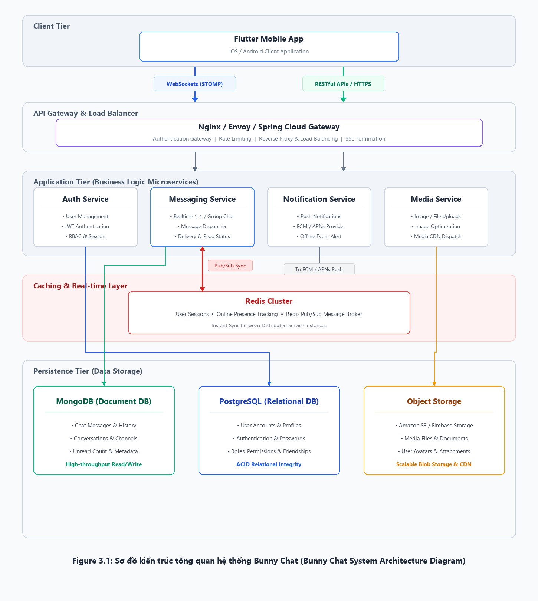<br>*(Figure 3.1: Sơ đồ kiến trúc tổng quan hệ thống Bunny Chat)* | 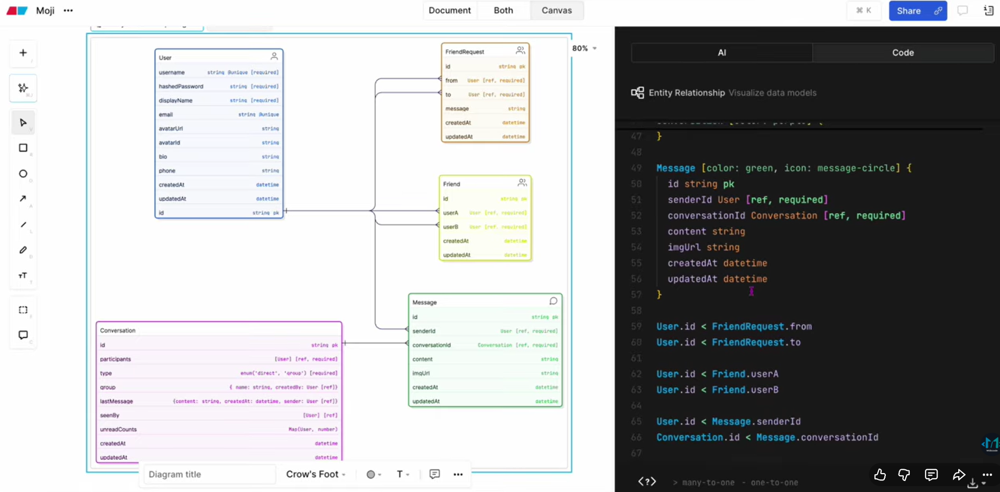<br>*(Sơ đồ cơ sở dữ liệu)* |

---

## 🚀 Tính Năng Chính

1. **Xác thực, Bảo mật & Khôi phục tài khoản (Auth & Recovery):**
   - Đăng ký, đăng nhập tài khoản với mã hóa mật khẩu an toàn.
   - **Khôi phục mật khẩu 2 bước (Forgot Password):**
     - *Bước 1 - Xác minh danh tính:* Kiểm tra trùng khớp Username / Email và Số điện thoại đã đăng ký tài khoản (`POST /api/auth/forgot/verify`).
     - *Bước 2 - Đặt lại mật khẩu:* Thiết lập mật khẩu mới trực tiếp mà không cần thoát khỏi ngữ cảnh đăng nhập (`POST /api/auth/forgot/reset-password`).
     - Hỗ trợ modal popup khôi phục mật khẩu mượt mà ngay tại trang đăng nhập và có trang fallback `/Forgot` riêng biệt.
   - Cơ chế xác thực kép: Middleware xác thực JWT Access Token kết hợp kiểm tra trạng thái Session trong MongoDB.
   - Tự động thu hồi phiên đăng nhập khi người dùng đăng xuất hoặc hết hạn.
2. **Giao diện hiện đại & Chủ đề (Theme Support):**
   - Hỗ trợ chuyển đổi nhanh giữa **Dark Mode** và **Light Mode**.
   - Thiết kế giao diện phản hồi mượt mà, tối ưu trên nhiều kích thước màn hình.
3. **Nhắn tin thời gian thực & Tương tác phong phú (Realtime Messaging & Interactions):**
   - Chat trực tiếp 1-1 giữa 2 người dùng với độ trễ tối thiểu qua SignalR kết hợp Optimistic UI (hiển thị tin nhắn ngay khi gõ gửi).
   - **Phân trang tin nhắn cuộn ngược thông minh (Cursor-based Infinite Scroll):**
     - Phân trang theo con trỏ thời gian (`GET /api/chat/{conversationId}/messages?limit=50&cursor=...`) giúp tối ưu hiệu năng MongoDB và bộ nhớ trình duyệt.
     - Khi cuộn lên đầu đoạn chat, tin nhắn cũ hơn tự động tải và chèn vào đầu danh sách mượt mà mà không làm nhảy vị trí đọc hiện tại.
   - **Đánh dấu đã đọc thời gian thực (Read Receipts / Seen Status):**
     - Tự động phát hiện và đánh dấu đã xem khi người dùng đang mở hoặc chuyển sang khung chat tương ứng.
     - Phát sự kiện realtime `read-message` qua SignalR để cập nhật trạng thái đọc và xóa số đếm chưa đọc (unread count) tức thì.
   - **Thả cảm xúc tin nhắn chuẩn phong cách Messenger (Reactions):**
     - Hỗ trợ bày tỏ cảm xúc bằng bộ 6 biểu tượng (👍, ❤️, 😂, 😮, 😢, 😡) với popup hiệu ứng pop-up/hover nhạy bén.
     - Huy hiệu reaction hiển thị tách bạch ở góc bong bóng tin nhắn kèm số lượng, hỗ trợ hủy hoặc đổi cảm xúc nhanh và đồng bộ realtime lập tức cho các bên tham gia.
   - **Tìm kiếm tin nhắn đa năng (Message Search):**
     - *Tìm kiếm trong cuộc trò chuyện:* Lọc nhanh tin nhắn trong đoạn chat hiện tại và cuộn highlight tới vị trí tin nhắn.
     - *Tìm kiếm toàn cục (Global Message Search):* Tra cứu từ khóa xuyên suốt tất cả các cuộc trò chuyện và nhóm chat, nhấp vào kết quả để chuyển ngay đến đúng ngữ cảnh hội thoại.
   - Trạng thái tin nhắn tức thời, hiển thị thời gian gửi và lịch sử trò chuyện.
4. **Chat nhóm (Group Chat):**
   - Khởi tạo phòng chat nhóm, tùy chỉnh tên nhóm và ảnh đại diện.
   - Thêm/xóa thành viên trong nhóm, xem danh sách người tham gia.
   - Phát tin nhắn realtime đến tất cả thành viên trong nhóm qua SignalR Groups.
5. **Mạng lưới bạn bè & Thông báo tức thì (Friend Network & Notifications):**
   - Tìm kiếm người dùng theo tên, email hoặc username.
   - **Chuông thông báo & Đồng bộ kết bạn thời gian thực (Realtime Notifications):**
     - Huy hiệu chuông thông báo (Notification Badge) hiển thị số lượng lời mời kết bạn chưa xử lý theo thời gian thực.
     - Đồng bộ sự kiện `friend-request-created`, `friend-request-accepted`, `friend-request-declined` qua SignalR ngay tức khắc giữa hai người dùng.
   - Gửi lời mời kết bạn (kèm tin nhắn chào hỏi), chấp nhận hoặc hủy yêu cầu kết bạn linh hoạt.
   - Quản lý danh sách bạn bè đã kết nối, xem trạng thái trực tuyến.
6. **Quản lý Hồ sơ & Cài đặt tài khoản (Profile & Account Settings):**
   - **Hồ sơ cá nhân (/me):** Tự do cập nhật họ, tên, nickname, số điện thoại liên hệ qua API `PUT /api/user/information`.
   - **Tùy biến thương hiệu cá nhân:** Hỗ trợ tính năng phối màu ngẫu nhiên cho logo/thương hiệu BunnyChat của riêng tài khoản.
   - **Xem trang cá nhân thành viên:** Hỗ trợ modal xem thông tin công khai (`GET /api/user/{id}/profile`) của bạn bè và các thành viên trong nhóm trực tiếp từ khung chat.
7. **Sẵn sàng triển khai Container & Đám mây:**
   - Đã cấu hình sẵn `Dockerfile`, `railway.json`, `nixpacks.toml` để triển khai tức thì lên Railway.

---

## 🛠️ Công Nghệ Sử Dụng

- **Backend:** ASP.NET Core (.NET 8/10), C#, ASP.NET Core Web API, SignalR Hub.
- **Frontend:** ASP.NET Core MVC (Razor Views), HTML5, CSS3, JavaScript thuần (Vanilla JS), Bootstrap.
- **Cơ sở dữ liệu:** MongoDB NoSQL (MongoDB Atlas Cloud Database).
- **Triển khai & DevOps:** Docker, Railway, Nixpacks.

---

## 📂 Cấu Trúc Thư Mục

```
BunnyChat/
├── BunnyChat/                     # Thư mục mã nguồn chính của ứng dụng
│   ├── Controllers/               # Web API & MVC Controllers (Auth, Chat, Friend, Group)
│   ├── Hubs/                      # SignalR ChatHub quản lý kết nối realtime
│   ├── Models/                    # Data models (User, Message, Conversation, FriendRequest)
│   ├── Services/                  # Business Logic & Database Services
│   ├── Views/                     # Razor Views cho giao diện người dùng
│   ├── wwwroot/                   # Static assets (CSS, JS, images, sounds)
│   └── Program.cs                 # Cấu hình dependency injection, middleware và SignalR
├── screenshots/                   # Hình ảnh giao diện thực tế của ứng dụng
├── ERD.png                        # Sơ đồ thực thể cơ sở dữ liệu MongoDB
├── Dockerfile                     # Docker container configuration
├── railway.json                   # Cấu hình triển khai Railway
└── README.md
```

---

## ⚙️ Hướng Dẫn Cài Đặt & Chạy

### 1. Chuẩn bị môi trường
- Cài đặt [.NET 8.0 SDK](https://dotnet.microsoft.com/download) hoặc cao hơn.
- Cấu hình chuỗi kết nối MongoDB trong `appsettings.json` hoặc biến môi trường:
```json
"MongoDBSettings": {
  "ConnectionString": "mongodb+srv://<username>:<password>@cluster0.mongodb.net/chatapp",
  "DatabaseName": "chatapp"
}
```

### 2. Biên dịch và khởi chạy
```bash
cd BunnyChat/BunnyChat
dotnet restore
dotnet build
dotnet run
```
Truy cập trình duyệt tại: `http://localhost:5000` (hoặc cổng được hiển thị trong terminal).
