# Tuyển Tập Các Dự Án Mã Nguồn Mở (Web, Mobile & Desktop Projects)

Kho lưu trữ tổng hợp các dự án phần mềm đa nền tảng bao gồm Ứng dụng Di động (Flutter), Ứng dụng Web (HTML5/CSS3/JS, ASP.NET Core, Python HTTP/REST), và Ứng dụng Máy tính Desktop (C# .NET Windows Forms).

---

## 📋 Danh Sách Tổng Hợp Các Dự Án

| STT | Tên Thư Mục | Tên Dự Án | Nền Tảng / Công Nghệ | Mô Tả Tóm Tắt |
| :---: | :--- | :--- | :--- | :--- |
| 1 | [`hutech_campus_app`](hutech_campus_app/) | HUTECH Campus App | Flutter (Mobile) | Khám phá các cơ sở đào tạo trường ĐH Công nghệ TP.HCM kèm bản đồ dẫn đường |
| 2 | [`mobile_Scanner_app`](mobile_Scanner_app/) | Mobile Scanner App | Flutter (Mobile) | Ứng dụng quét mã vạch và mã QR tốc độ cao, hỗ trợ âm thanh phản hồi |
| 3 | [`showroom_web`](showroom_web/) | GF Furniture Showroom | HTML5 / CSS3 (Web) | Website giới thiệu showroom nội thất cao cấp với giao diện sang trọng |
| 4 | [`App_Web_Quet_Ma`](App_Web_Quet_Ma/) | SPX Express Scanner | Flutter + Node.js + MySQL | Hệ thống phân loại bao hàng TO, quét mã vạch & tra cứu đơn hàng logistics |
| 5 | [`BunnyChat`](BunnyChat/) | BunnyChat Platform | ASP.NET Core + SignalR + MongoDB | Ứng dụng trò chuyện trực tuyến realtime 1-1 và nhóm, Dark/Light mode |
| 6 | [`dashboardTKT`](dashboardTKT/) | Tuyển Dụng TPD | Python + MongoDB + Telegram Bot | Bảng điều khiển quản lý tuyển dụng & bot tự động bóc tách ứng viên từ tin nhắn |
| 7 | [`web_Desktop_Hospital`](web_Desktop_Hospital/) | Hospital Management (HMS) | C# .NET WinForms + SQL Server | Phần mềm desktop 3 lớp quản lý bệnh nhân, lịch hẹn, khám bệnh & kho dược |

---

## 🌟 Chi Tiết Từng Dự Án & Hình Ảnh Giao Diện (UI Preview)

### 1. [HUTECH Campus App](hutech_campus_app/)
- **Mô tả:** Ứng dụng di động hỗ trợ sinh viên và khách tham quan khám phá 4 cơ sở đào tạo chính của HUTECH (Trụ sở Điện Biên Phủ, Cơ sở Ung Văn Khiêm, Thu Duc Campus, Hiep Phuoc Campus).
- **Tính năng nổi bật:** Danh sách cơ sở với hình ảnh sống động, xem chi tiết địa chỉ, số hotline, danh mục chuyên ngành đào tạo, tích hợp mở Google Maps dẫn đường trực tiếp.
- **Công nghệ:** Flutter SDK, Dart, Material 3, `url_launcher`.

| Màn Hình Chính | Màn Hình Chi Tiết |
| :---: | :---: |
| 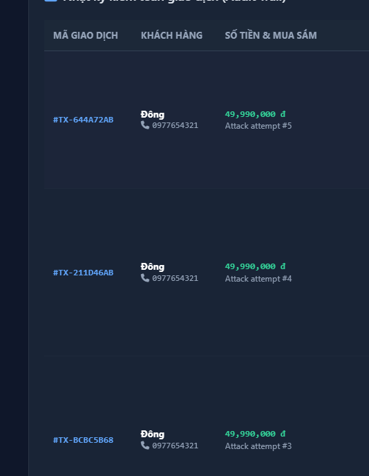 | 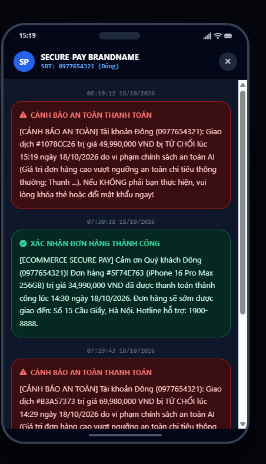 |

---

### 2. [Mobile Scanner App](mobile_Scanner_app/)
- **Mô tả:** Ứng dụng quét mã vạch (Barcode) và mã QR đa năng với hiệu năng cao và độ trễ thấp.
- **Tính năng nổi bật:** Nhận diện đa định dạng (QR, EAN-13, Code 128, Code 39...), giao diện quét hiện đại với khung nhắm (scanner overlay), điều khiển bật/tắt đèn flash và lật camera, phát âm thanh bíp (`beep.mp3`) khi quét thành công.
- **Công nghệ:** Flutter SDK, `mobile_scanner`, `audioplayers`.

| Giao Diện Quét Mã Barcode / QR |
| :---: |
| 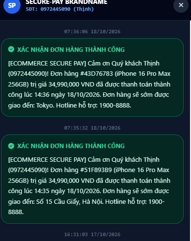 |

---

### 3. [GF Furniture Showroom Web](showroom_web/)
- **Mô tả:** Website giới thiệu showroom nội thất cao cấp Grand Furniture (GF) mang phong cách tối giản, hiện đại và sang trọng.
- **Tính năng nổi bật:** Header điều hướng cố định với hiệu ứng hover mượt mà, Banner Hero hình ảnh chất lượng cao, Bộ sưu tập sản phẩm danh mục nội thất, Chân trang liên hệ chuyên nghiệp.
- **Công nghệ:** HTML5 thuần, CSS3 (Flexbox, CSS Grid, Custom Fonts, Media Queries Responsive).

| Giao Diện Trang Chủ GF Furniture |
| :---: |
| 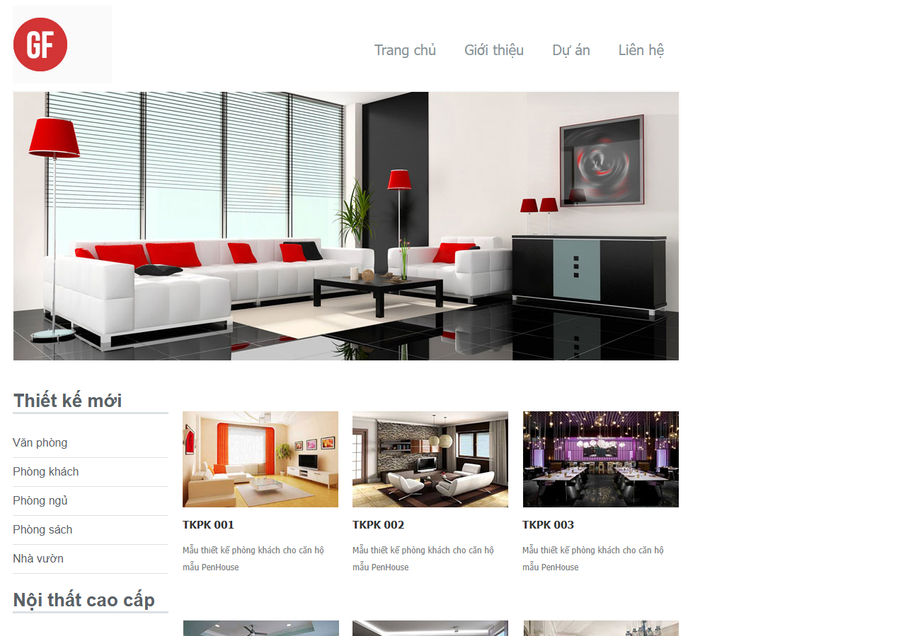 |

---

### 4. [SPX Express Scanner System](App_Web_Quet_Ma/)
- **Mô tả:** Hệ thống quản lý và phân loại bao hàng vận chuyển (Transfer Order - TO) dành cho các trung tâm phân loại / bưu cục logistics SPX Express.
- **Tính năng nổi bật:** Quét mã bưu kiện đưa vào bao hàng TO, đếm số lượng kiện tự động, kiểm tra trùng lặp mã, phát âm thanh cảnh báo (Beep/Error), in phiếu thông tin bao hàng (Bill TO), tra cứu chi tiết vận đơn.
- **Công nghệ:** Flutter (Mobile App), Node.js Express (Backend Server), MySQL/MariaDB & SQLite (Offline Storage), Python (Mock Data Generator).

| Menu Điều Hành Nghiệp Vụ | Phân Loại Bao Hàng (TO) | Danh Sách Bao Hàng Đã Đóng |
| :---: | :---: | :---: |
| 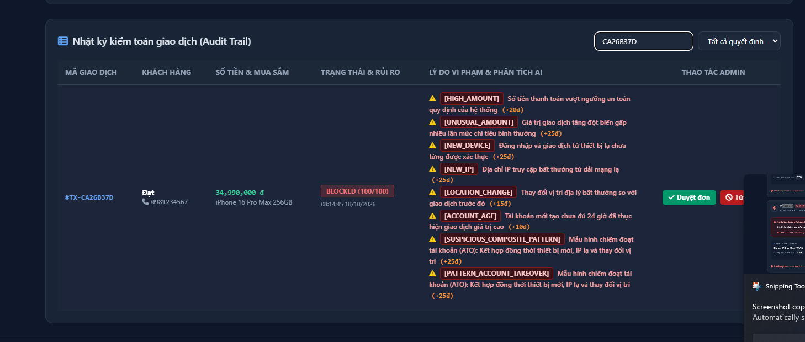 | 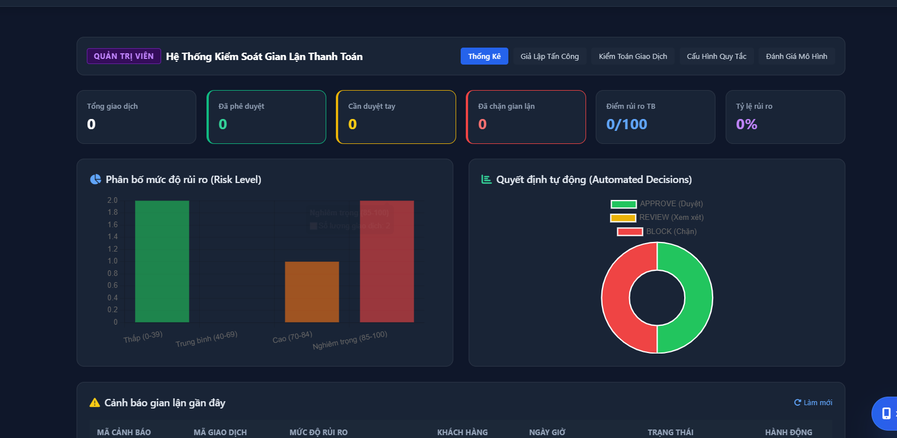 | 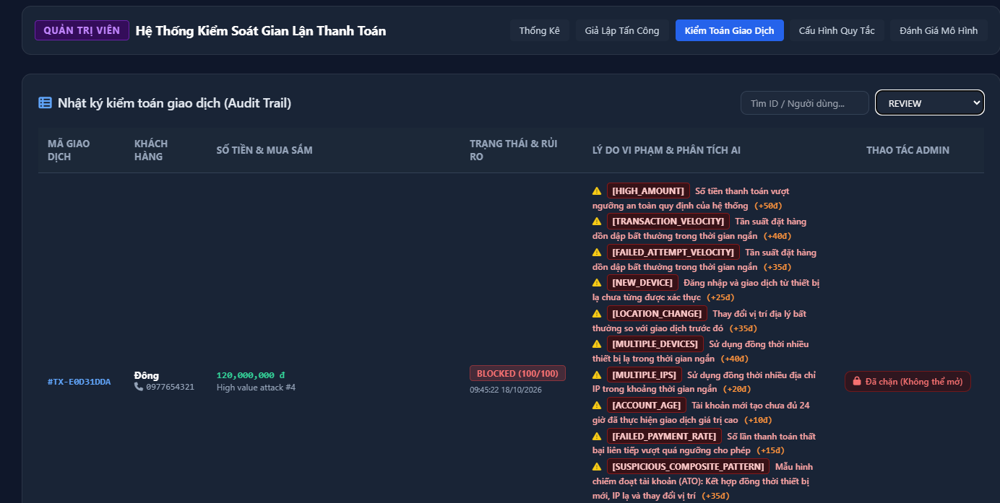 |

---

### 5. [BunnyChat Realtime Chat](BunnyChat/)
- **Mô tả:** Nền tảng nhắn tin trực tuyến thời gian thực hiện đại, cho phép người dùng kết nối, trò chuyện trực tiếp 1-1 và lập nhóm chat.
- **Tính năng nổi bật:** Xác thực bảo mật với JWT Token và MongoDB Session, chuyển đổi giao diện Dark/Light mode, truyền nhận tin nhắn hai chiều siêu tốc qua SignalR Hub, tìm kiếm người dùng và kết bạn.
- **Công nghệ:** ASP.NET Core MVC + Web API (.NET 8), SignalR Realtime Hub, MongoDB Atlas NoSQL, Docker, Railway.

| Giao Diện Chat (Dark Mode) | Giao Diện Chat (Light Mode) | Trò Chuyện Trực Tiếp 1-1 |
| :---: | :---: | :---: |
| 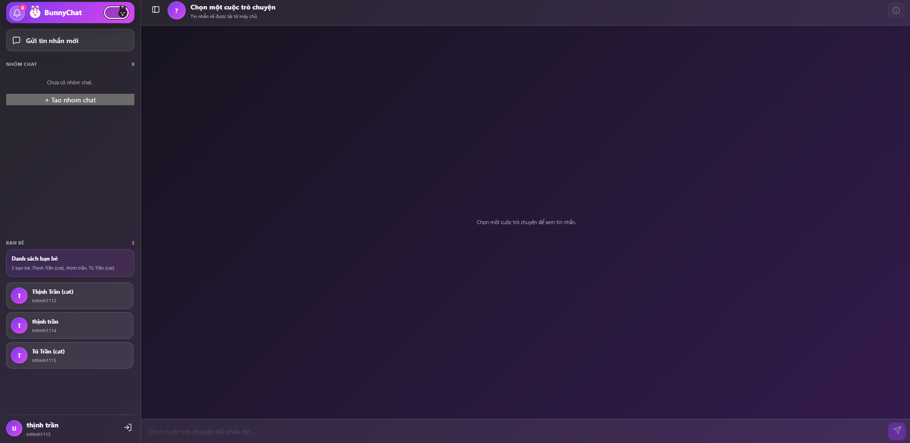 | 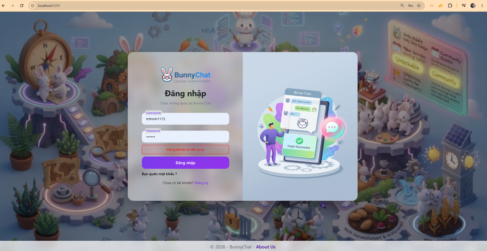 | 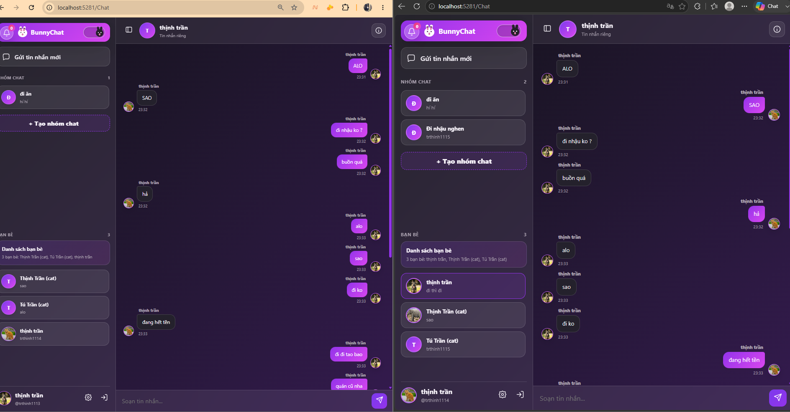 |

---

### 6. [Tuyển Dụng TPD Dashboard](dashboardTKT/)
- **Mô tả:** Bảng điều khiển quản lý hoạt động tuyển dụng nhân sự toàn diện, theo dõi tiến độ các đơn hàng tuyển dụng và mạng lưới cộng tác viên.
- **Tính năng nổi bật:** Lọc và quản lý đơn tuyển dụng theo ngành nghề, theo dõi hồ sơ ứng viên qua từng vòng phỏng vấn, lưu trữ CV với bộ nhớ đệm nhị phân, tích hợp bot Telegram tự động trích xuất thông tin ứng viên từ tin nhắn nhóm và đồng bộ vào hệ thống.
- **Công nghệ:** Python HTTP Server, MongoDB Atlas, Telegram Bot API, Single Page Application (HTML5/CSS3/JavaScript).

| Bảng Điều Khiển Quản Lý Tuyển Dụng TPD |
| :---: |
| 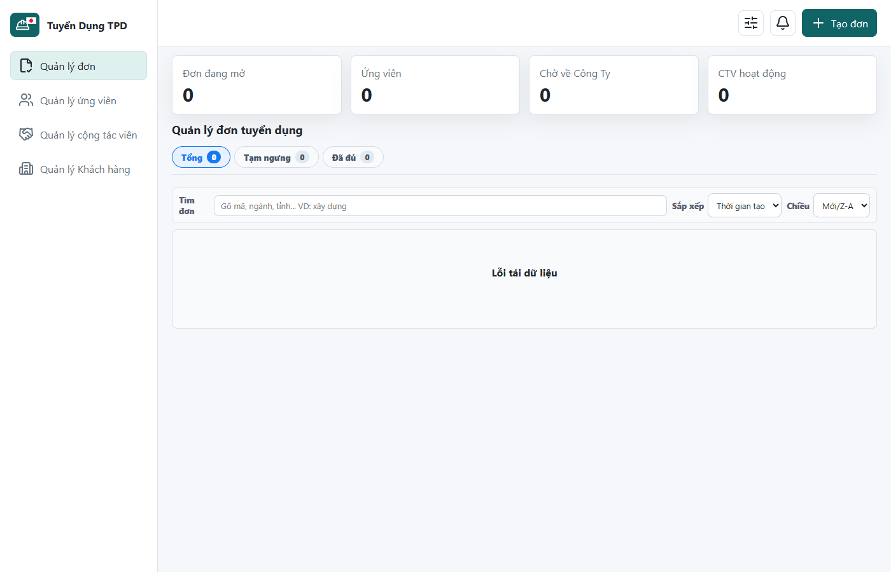 |

---

### 7. [Hospital Management System (HMS)](web_Desktop_Hospital/)
- **Mô tả:** Phần mềm quản lý phòng khám và bệnh viện đa khoa trên nền tảng Desktop, vận hành theo mô hình kiến trúc 3 lớp (3-Tier Architecture) vững chắc.
- **Tính năng nổi bật:** Đăng nhập an toàn phân quyền vai trò (Admin, Bác sĩ, Lễ tân, Dược sĩ), quản lý hồ sơ bệnh nhân, lập lịch hẹn khám bệnh, chẩn đoán lâm sàng, quản lý kho dược và xuất đơn thuốc, tính viện phí và xuất hóa đơn.
- **Công nghệ:** C# .NET Framework, Windows Forms, Entity Framework 6, Microsoft SQL Server.

| Giao Diện Đăng Nhập | Quản Lý Hồ Sơ Bệnh Nhân | Quản Lý Lịch Hẹn Khám |
| :---: | :---: | :---: |
| 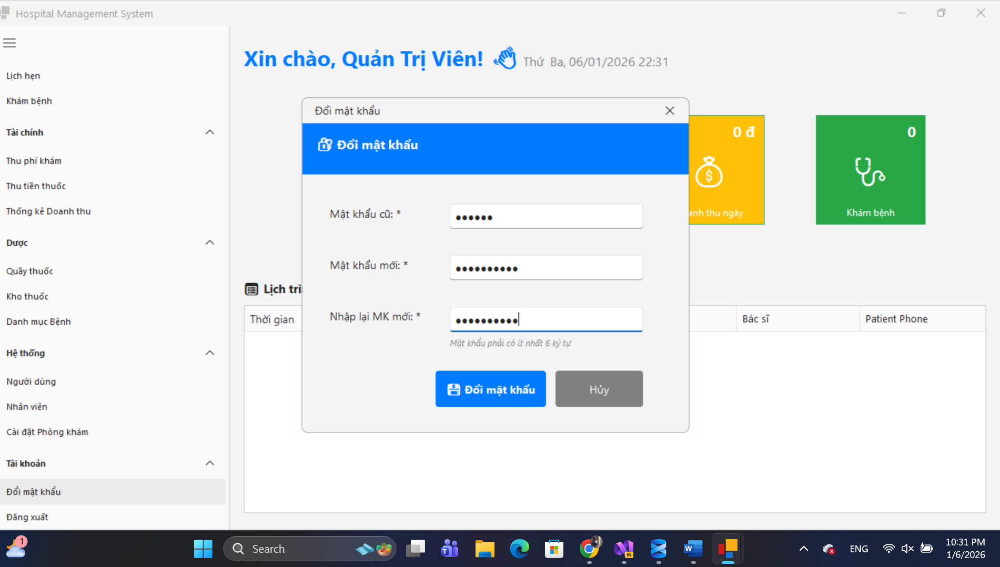 | 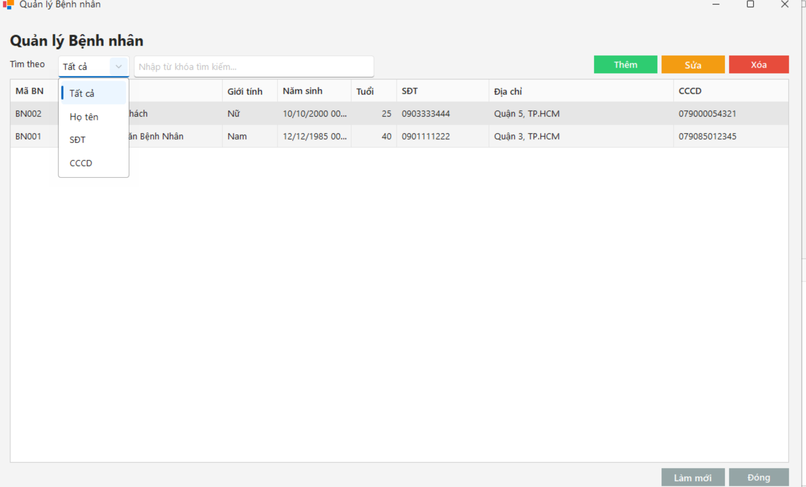 | 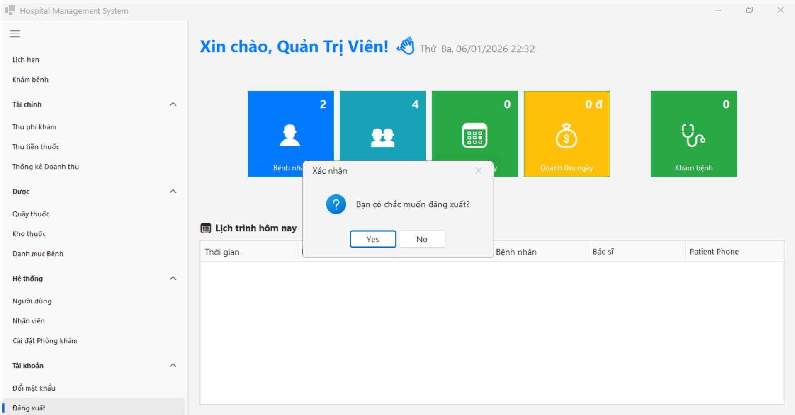 |

---

## 🛠️ Yêu Cầu Môi Trường Chung

- **Flutter / Dart:** Flutter SDK 3.x+ (cho `hutech_campus_app`, `mobile_Scanner_app`, `App_Web_Quet_Ma`).
- **Node.js:** Node.js 18+ (cho Backend `App_Web_Quet_Ma`).
- **.NET SDK:** .NET 8.0+ SDK (cho `BunnyChat`), .NET Framework 4.8 / Visual Studio (cho `web_Desktop_Hospital`).
- **Python:** Python 3.10+ (cho `dashboardTKT`).
- **Cơ sở dữ liệu:** MongoDB Atlas, MySQL 8.0, Microsoft SQL Server.
