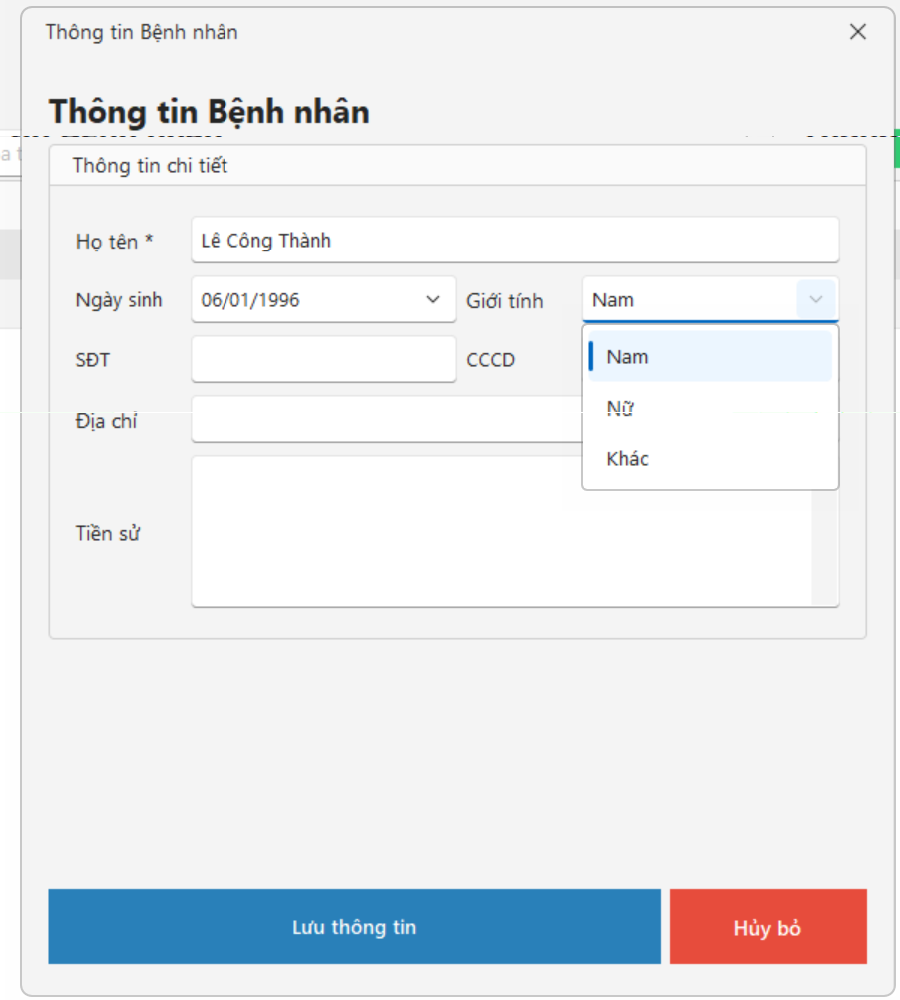
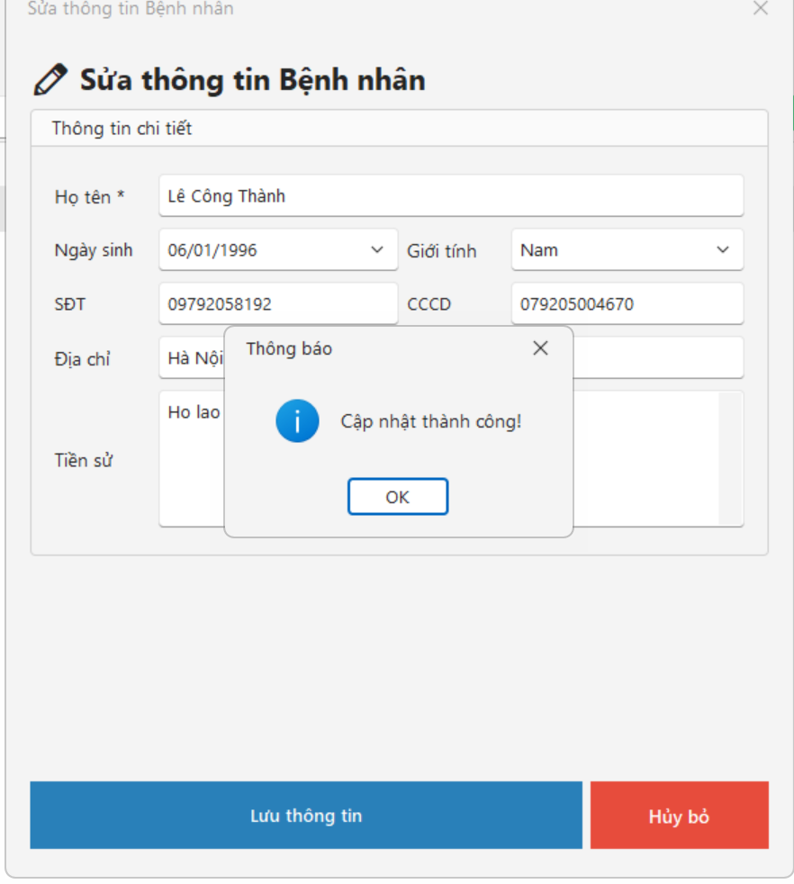
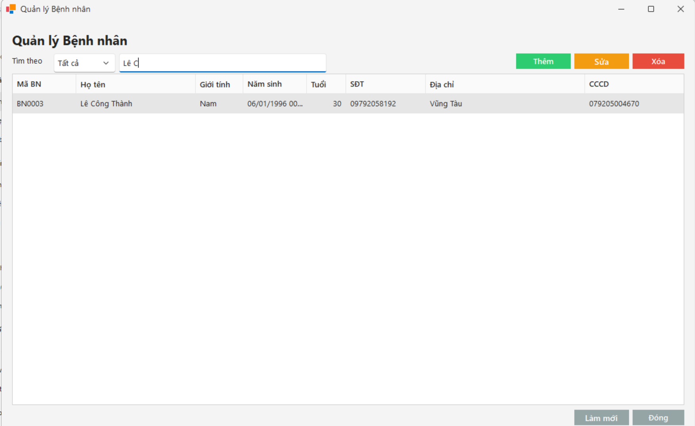
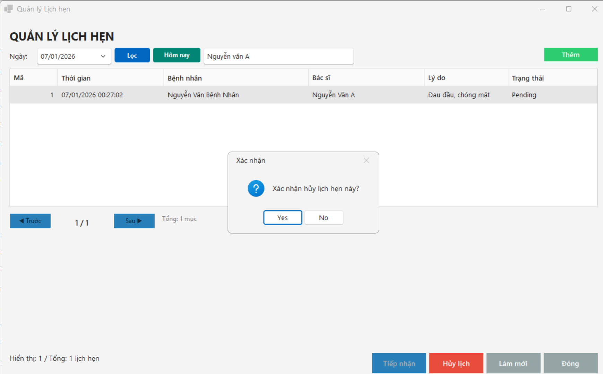

# Hệ Thống Quản Lý Phòng Khám & Bệnh Viện (Hospital Management System - HMS)

Ứng dụng Desktop quản lý phòng khám đa khoa chuyên nghiệp phát triển trên nền tảng .NET Windows Forms áp dụng Kiến trúc 3 lớp (3-Tier Architecture), tích hợp Entity Framework 6 và hệ quản trị cơ sở dữ liệu Microsoft SQL Server. Phần mềm hỗ trợ toàn diện quy trình tiếp nhận, khám chữa bệnh, quản lý kho dược và xuất viện.

---

## 📸 Giao Diện Ứng Dụng (UI Screenshots)

| 1. Giao Diện Đăng Nhập An Toàn | 2. Bảng Điều Khiển Trung Tâm |
| :---: | :---: |
|  |  |

| 3. Quản Lý Danh Sách Bệnh Nhân | 4. Thêm Mới Hồ Sơ Bệnh Nhân |
| :---: | :---: |
|  |  |

| 5. Cập Nhật Thông Tin Bệnh Nhân | 6. Quản Lý Lịch Hẹn Khám Bệnh |
| :---: | :---: |
|  |  |

| 7. Thêm Mới & Đặt Lịch Hẹn Khám |
| :---: |
|  |

---

## 🚀 Tính Năng Chính

1. **Xác thực & Phân quyền người dùng (Authentication & RBAC):**
   - Đăng nhập bảo mật theo vai trò: Quản trị viên (Admin), Bác sĩ (Doctor), Lễ tân (Receptionist), Dược sĩ (Pharmacist).
   - Đổi mật khẩu có kiểm tra định dạng và chính sách an toàn.
2. **Quản lý tiếp nhận & Hồ sơ bệnh nhân (Patient Management):**
   - Lưu trữ đầy đủ lý lịch: Họ tên, ngày sinh, giới tính, CCCD/BHYT, địa chỉ, số điện thoại.
   - Tìm kiếm bệnh nhân tức thì theo từ khóa, mã bệnh nhân hoặc số điện thoại.
   - Thêm, sửa, xóa và truy xuất lịch sử khám bệnh của từng bệnh nhân.
3. **Quản lý lịch hẹn khám (Appointment Scheduling):**
   - Đặt lịch hẹn khám bệnh theo bác sĩ chuyên khoa và khung giờ cụ thể.
   - Quản lý trạng thái lịch hẹn: Chờ khám, Đang khám, Đã hoàn thành, Đã hủy hẹn.
4. **Khám bệnh, Chẩn đoán & Lâm sàng (Clinical & Diagnosis):**
   - Ghi nhận triệu chứng, chỉ số sinh tồn (huyết áp, nhịp tim, cân nặng).
   - Nhập kết luận chẩn đoán y khoa và tiền sử bệnh.
5. **Quản lý kho dược & Đơn thuốc (Pharmacy & Prescription):**
   - Danh mục thuốc, đơn vị tính, giá bán, số lượng tồn kho.
   - Cảnh báo thuốc sắp hết hạn sử dụng hoặc sắp hết hàng.
   - Kê đơn thuốc điện tử tương ứng với từng lượt khám.
6. **Thanh toán & Hóa đơn viện phí (Billing & Invoicing):**
   - Tính toán chi phí khám bệnh và tổng tiền thuốc theo đơn.
   - Xuất và in phiếu thu/hóa đơn thanh toán cho bệnh nhân.
7. **Tối ưu hóa hiệu năng giao diện:**
   - Tích hợp `PaginationHelper` giúp phân trang dữ liệu thông minh, không làm chậm giao diện khi cơ sở dữ liệu có hàng ngàn bản ghi.
   - Chuẩn hóa thông báo và thao tác qua `UIHelper`.

---

## 🛠️ Công Nghệ Sử Dụng & Kiến Trúc

- **Ngôn ngữ & Nền tảng:** C# .NET Framework / Windows Forms.
- **Kiến trúc phần mềm:** Mô hình 3 lớp (3-Tier Architecture):
  - **Presentation Layer (GUI):** Các WinForms giao diện người dùng.
  - **Business Logic Layer (BLL):** Xử lý quy tắc nghiệp vụ, tính toán chi phí, kiểm tra logic.
  - **Data Access Layer (DAL):** Tương tác cơ sở dữ liệu thông qua Entity Framework 6.
- **Cơ sở dữ liệu:** Microsoft SQL Server.
- **Công cụ phát triển:** Visual Studio IDE.

---

## 📂 Cấu Trúc Thư Mục

```
web_Desktop_Hospital/
├── web_Desktop_Hospital/          # Mã nguồn ứng dụng Windows Forms
│   ├── BLL/                       # Lớp xử lý nghiệp vụ (Business Logic Layer)
│   ├── DAL/                       # Lớp truy xuất dữ liệu (Data Access Layer - EF6)
│   ├── GUI/                       # Lớp giao diện người dùng (Forms & Controls)
│   │   ├── LoginForm.cs           # Giao diện đăng nhập
│   │   ├── MainDashboard.cs       # Bảng điều khiển chính
│   │   ├── PatientForm.cs         # Form quản lý bệnh nhân
│   │   ├── AppointmentForm.cs     # Form quản lý lịch hẹn
│   │   ├── DiagnosisForm.cs       # Form khám và chẩn đoán
│   │   └── PharmacyForm.cs        # Form quản lý thuốc & viện phí
│   ├── Helpers/                   # Các thư viện trợ giúp (PaginationHelper, UIHelper)
│   └── App.config                 # Cấu hình ConnectionString SQL Server
├── screenshots/                   # Hình ảnh chụp màn hình các chức năng
├── Báocao.docx                    # Tài liệu báo cáo thiết kế đồ án chi tiết
└── README.md
```

---

## ⚙️ Hướng Dẫn Cài Đặt & Chạy

### 1. Chuẩn bị Cơ sở dữ liệu
- Khởi chạy Microsoft SQL Server và SQL Server Management Studio (SSMS).
- Cấu hình cơ sở dữ liệu `HospitalDb`.

### 2. Cấu hình chuỗi kết nối
Mở tệp `App.config` trong thư mục dự án và cập nhật chuỗi kết nối:
```xml
<connectionStrings>
  <add name="HospitalDbContext" 
       connectionString="Server=YOUR_SERVER_NAME;Database=HospitalDb;Integrated Security=True;" 
       providerName="System.Data.SqlClient" />
</connectionStrings>
```

### 3. Mở và biên dịch dự án
- Mở tệp giải pháp `.sln` bằng **Visual Studio**.
- Nhấn **F5** hoặc nút **Start** để khởi chạy ứng dụng.
